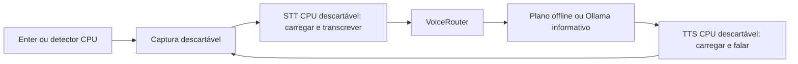
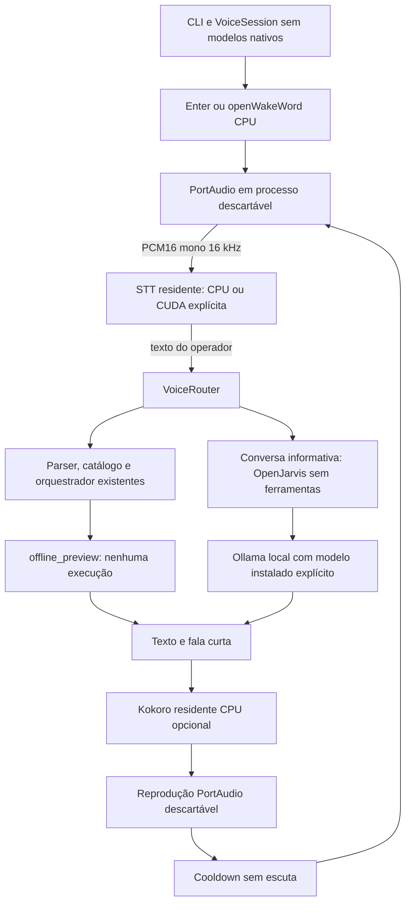
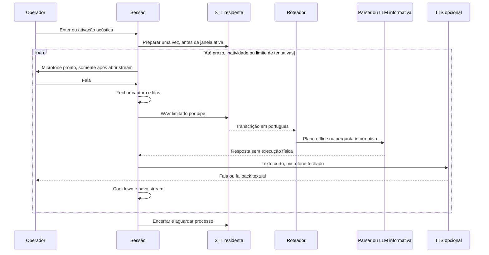

# ADR-0006 — Inferência residente e áudio isolado

Data: 2026-10-19. Status: implementado e verificado offline.
Complementa e atualiza as decisões de ciclo de vida do
[ADR-0005](0005-local-voice-session.md). Homologação acústica pendente.

## Problema

O worker original ocultava CUDA em todas as operações e carregava STT/TTS a
cada chamada. O operador relatou PortAudio `-9987` ao abrir o microfone depois
de carregar CUDA no mesmo processo. Não reproduzimos esse erro nesta entrega:
preservamos processos distintos para áudio e inferência.

## Antes

## Depois

STT e TTS usam processos residentes separados, pipes privados e JSON com
prefixo de comprimento. Não há socket, servidor, pickle ou caminho de arquivo
de áudio no protocolo residente. Quadros têm até 2 MiB, IDs sequenciais e uma
operação simultânea por worker. Inicialização só ocorre uma vez por processo;
depois somente `transcribe` ou `synthesize`, conforme o tipo. PCM/WAV é validado
antes da inferência e da reprodução. Não se aceitam nomes de operações de shell.

Captura, reprodução e espera acústica mantêm supervisão descartável. Seus
arquivos temporários privados de IPC são fechados automaticamente; não há
gravação persistente ou exportação automática de áudio. A captura importa os
helpers stdlib de `openjarvis._audio_pcm`, também reexportados por `voice_io`.
Isso evita inicializar o registro de backends de fala/CTranslate2 no microfone.

Timeout ou cancelamento mata o grupo do worker, aguarda o processo, fecha os
pipes e remove o diretório temporário. Linux/WSL arma `PR_SET_PDEATHSIG` antes
de importar bibliotecas nativas para encerrar o filho se o pai morrer. Falhas
não reaproveitam resultados atrasados nem repetem áudio. Recuperar STT exige
nova ativação explícita; fechamento definitivo impede reinício.

## Política por operação

| Operação | GPU | Retenção |
| --- | --- | --- |
| STT | CPU/int8 padrão; CUDA/float16 explícito | Uma instância até fechar a sessão ou falhar |
| Captura, reprodução | `CUDA_VISIBLE_DEVICES=''` | Um processo por operação |
| Wake word | CPU | Uma espera limitada, com fallback Enter |
| TTS Kokoro | CPU | Inicialização preguiçosa; uma instância por sessão |
| Cliente LLM | GPU oculta no cliente | Processo limitado por solicitação |
| Servidor Ollama existente | Política própria do serviço | Não alterada globalmente |

Só STT CUDA recebe o índice físico selecionado em `CUDA_VISIBLE_DEVICES`.
O backend enxerga esse dispositivo como índice lógico zero. Antes do `exec`,
o supervisor descobre os diretórios `.so` nos metadados dos pacotes pip
`nvidia-cublas-cu12` e `nvidia-cudnn-cu12` e compõe o ambiente do filho. Não
edita o sistema nem exige exportação manual de `LD_LIBRARY_PATH`.
CTranslate2 verifica GPU/tipos suportados; uma combinação incompatível produz
erro explícito, sem migrar silenciosamente para outra precisão/dispositivo.

## Conversação, limites e segurança

O parser determinístico e os aliases S6/S7.1 continuam como fonte dos planos.
Uma pergunta informativa conservadoramente reconhecida pode chegar ao Ollama;
uma instrução desconhecida não ganha uma rota executora. O classificador é
um filtro de experiência, não uma autorização. A barreira física é a ausência
de ferramentas, clientes e credenciais nessa rota.

A CLI usa janela de 300 s, inatividade de 30 s e até 20 tentativas de captura
por ativação. O carregamento inicial do STT tem orçamento separado, padrão
120 s. As configurações antigas de `VoiceConfig` mantêm os defaults por
compatibilidade; a CLI seleciona explicitamente os novos valores.
Falha de microfone/STT fecha a janela, preservando a interface para Enter.
LLM/TTS indisponíveis fornecem texto. `LISTENING` só aparece após abrir stream.

Histórico informativo volátil: quatro pares/1800 caracteres, prompt até 3800,
resposta armazenada até 700; tokens de saída 192 e contexto Ollama 4096 por
padrão. Não há memória de comandos. O contexto pode atravessar ativações
próximas; a próxima ativação descarta contexto vencido pelo prazo de
inatividade. `limpar contexto`, cancelamento e fechamento também o descartam.

A persona central reside em `voice_persona.py`. Fala informativa é limitada
a 380 caracteres; planos têm resumo com negação explícita de execução física.
Afirmações conhecidas de sucesso físico geradas pelo modelo são substituídas
antes de exibição/fala/histórico. Esse filtro não certifica a veracidade geral
da LLM. Texto do modelo nunca retorna ao parser nem se torna `OperatorTurn`.

Uma requisição LLM por vez, modelo exato instalado e até 4 GiB de pesos por
padrão. A política anterior de RAM/swap continua aplicada. Isso limita carga,
mas não reserva RAM/VRAM nem garante ausência de OOM. Se o cliente expira,
encerra seu processo e bloqueia novas inferências até reiniciar a sessão:
o serviço Ollama externo pode ainda concluir o pedido; não o matamos.

Half-duplex, novas filas e cooldown de 0,8 s continuam obrigatórios. Wake word
tem limite adicional de seis detecções por minuto; ultrapassá-lo aciona fallback
manual. Nem wake word nem voz identificam/autenticam o operador. Não há nova
permissão física. Código de terceiros/modelos continuam exigindo confiança;
os workers não constituem uma sandbox de rede do sistema operacional.

## Consequências e verificação

Evita-se recarregar STT durante a conversa; em troca, sua memória permanece
ocupada enquanto a sessão vive. TTS residente também consome RAM se habilitado.
Coexistência de inferência STT/Ollama na RTX 4070 exige medição supervisionada;
o inventário e a carga isolada do STT não comprovam essa coexistência.

O runner offline bloqueia hardware, rede, subprocessos reais e modelos nativos.
Testes com pipes locais/fakes verificam protocolo, um carregamento/vários turnos,
cancelamento, encerramento, falhas, configuração CUDA e ausência de execução.
Resultados de hardware e pendências estão no
[relatório consolidado](../reports/sprint-7-consolidation.md).
