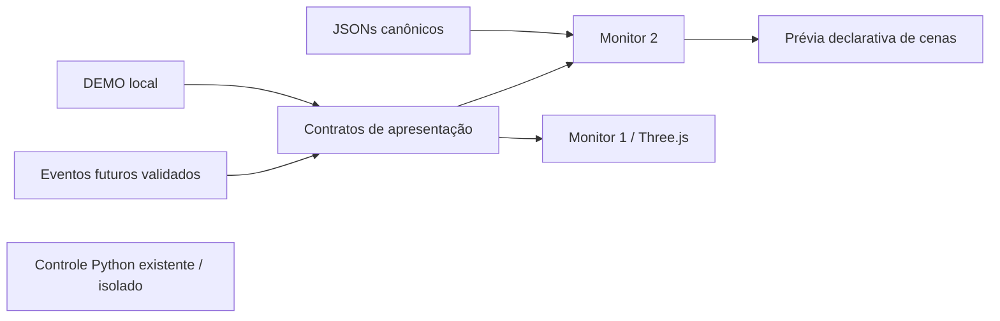

# ADR-0007 — Apresentação dual-monitor sem autoridade operacional

Status: implementada localmente; homologação visual pendente.
Data: 20/10/2026.

## Decisão

Manter React/TypeScript/Vite em `projects/jarvis-room/frontend`, separado do frontend
OpenJarvis. Monitor 1 usa ambiente derivado da referência aprovada mais geometria
procedural Three.js/React Three Fiber. Monitor 2 usa os arquivos canônicos de
equipamentos e cenas; não mantém inventário concorrente.

As rotas `/monitor/1` e `/monitor/2` são independentes e compartilham somente
apresentação DEMO em memória. Uma interface tipada recebe futuros eventos somente
leitura, sem implementar transporte ou novos endpoints nesta sprint.

Não existe seta de execução da UI para Python ou Home Assistant. Botões de cena
abrem planos, sem POST. Não são expostas credenciais nem métodos de controle.
Fontes, modelos e serviços iniciam desconhecidos; planejado não significa conectado.

## Consequências

A renderização visual pode evoluir sem alterar contratos de autorização/voz.
O ambiente híbrido prioriza a referência com custo menor que modelar toda a sala.
A sala estática não oferece parallax arquitetônico, e sua edição exige comparação
visual humana. A esfera não é uma textura ou vídeo em loop.

O adaptador futuro precisa de transporte autenticado, política de dados obsoletos
e homologação de sensores/TTS. A proteção HTTP/CSP do servidor de produção deverá
ser reaplicada pelo servidor escolhido. Nenhuma função operacional é autorizada
por esta ADR. Voz real, inferência, GPU benchmark e dispositivos não foram testados.
