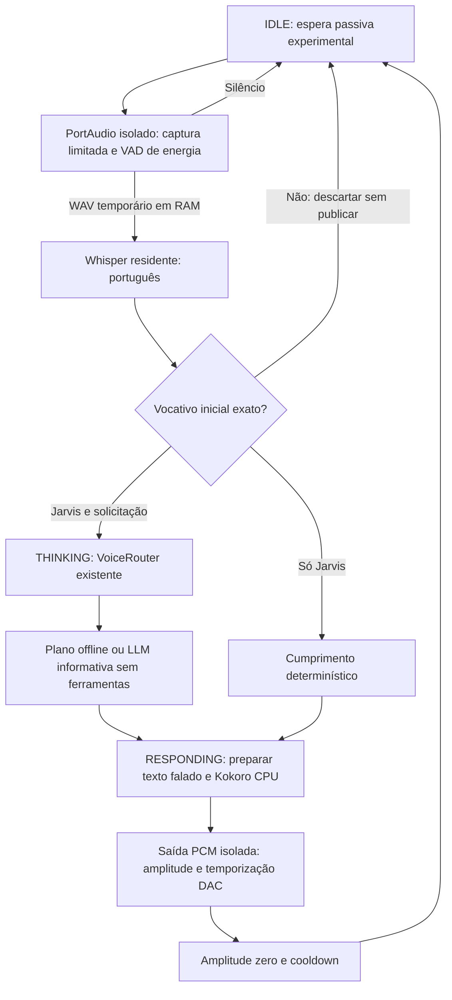

# Sprint 9.1 — vocativo obrigatório, persona e voz brasileira

Guia atual da aplicação da Sala Temática. Não altera padrões globais do
OpenJarvis. [Relatório e resultados](../reports/sprint-9-1-acceptance.md).
[Transporte SSE, dashboard e HA somente leitura](voice-frontend-integration.md).

## Comportamento

**Cada fala dirigida ao assistente precisa começar com a palavra `Jarvis`.**
Enter ou detector acústico abrem a captura, mas não dispensam esse requisito,
nem há exceção para perguntas de acompanhamento. O histórico curto ajuda a
responder; não concede ativação ou autorização.

| Transcrição | Resultado |
| --- | --- |
| `Jarvis.` | `Sim, senhor. Em que posso ajudá-lo?`, determinístico, sem Ollama |
| `Jarvis, quem é você?` | Roteador existente, resposta textual e TTS disponível |
| `Jarvis, explique o projeto.` | Conversa informativa, se LLM habilitada |
| `Jarvis, pode explicar isso de outra forma?` | Acompanhamento com histórico limitado |
| `Jarvis, ligue os LEDs.` | Plano `offline_preview`; nenhum comando físico enviado |
| `Explique o projeto.` / `Ligue os LEDs.` | Descarte silencioso antes do roteador |
| `Você conhece o Jarvis?` / `Estamos conversando sobre Jarvis` | Descarte silencioso |
| `Jarvisinho`, `Jervis`, `Járvis`, `Hey Jarvis`, `J.A.R.V.I.S.` | Não são o vocativo aceito |

Aceitam-se caixa alta/baixa ASCII, espaços iniciais, aspas/parêntese de
abertura e separadores simples após o nome: espaço, vírgula, ponto,
interrogação/exclamação, dois-pontos, ponto-e-vírgula e aspas/parêntese de
fechamento. `Jarvis2`, `Jarvis_nome` e `Jarvis-like` não correspondem. Não há
fuzzy matching, substituição automática de verbos ou busca do nome no meio da
frase. Texto de controle, linhas múltiplas e mais de 256 caracteres são rejeitados.
`Jarvis, sair` encerra; `Jarvis, cancelar` fecha o ciclo atual;
`Jarvis, limpar contexto` apaga o histórico. Ctrl+C funciona também durante TTS.
Na escuta contínua, cancelar um ciclo retorna à espera; para desligar o
microfone e liberar modelos, use Ctrl+C ou `Jarvis, sair` fora da reprodução.

## Voz e personalidade

Padrões centralizados em `voice_persona.py`: Kokoro local **`pm_alex`**, velocidade
**0,92**, volume **0,5**. O backend permanece CPU, pipeline brasileiro `p`/pt-br,
sem API externa. A CLI permite `pm_santa`, `pm_alex` e `pf_dora` com arquivos
locais correspondentes. Velocidade aceita 0,5–2, volume 0–1 e dispositivo é
selecionado pelo índice do diagnóstico. Não há ajuste de pitch ou clonagem.

A persona pede estilo original calmo, elegante e técnico, frases breves,
humor discreto e uso ocasional de “senhor”. Não repete apresentação a cada
turno nem inventa estados ou confirmações físicas. A identidade escrita
continua **J.A.R.V.I.S.**. Apenas na preparação de TTS, nomes completos como
`J.A.R.V.I.S.`, `j.a.r.v.i.s`, `J. A. R. V. I. S.` e `JARVIS` tornam-se
`Jarvis`. Outras siglas, UI, IDs, logs e histórico não são reescritos.

Exemplo: tela `Sou J.A.R.V.I.S., o assistente da Sala Temática.`; síntese
`Sou Jarvis, o assistente da Sala Temática.`. Não há normalização linguística
de comandos físicos. Presença do tensor da voz não comprova timbre grave,
inteligibilidade, naturalidade ou pronúncia: isso exige audição humana.

## Estratégia de escuta

O modo padrão continua manual por Enter. O modo **`--continuous-experimental`**
é opt-in e reutiliza captura S7 com VAD de energia e o único Whisper residente.
Não é detector acústico dedicado, mecanismo de autenticação ou solução
comprovada de baixo consumo. Não baixa ou treina modelos.



Durante captura/STT passivos o holograma continua IDLE e a amplitude zero.
**IDLE nesse modo não significa microfone desligado.** Depois da validação,
o pedido entra em THINKING/RESPONDING; o chamado isolado vai diretamente a
RESPONDING. LISTENING/TRANSCRIBING permanecem na captura manual explícita.
O callback real de abertura confirma saúde do microfone; não anuncia escuta
antes de o stream abrir. Nenhuma fala descartada vai ao Monitor 2, LLM ou TTS.
O cumprimento também não é publicado como par de conversa informativa.

O stream fecha antes do STT, mantendo isolamento PortAudio/CUDA; não há captura
durante síntese, reprodução ou cooldown de 0,8 s. Cada ciclo usa fila nova.
A reprodução mantém cálculo RMS do PCM real, suavização e relógio DAC S9.
Falha/cancelamento/fim zeram amplitude; desconexão SSE limpa o estado visual.
Uma proteção suplementar compara a fala sintetizada recente, inclusive entre
ciclos, sem reinterpretar a resposta como comando. Ela não substitui half-duplex.

Limites: captura até 15 s por padrão (1–30), silêncio inicial até 4 s,
finalização após 1,2 s de silêncio e pausa entre ciclos de 0,25 s (0,2–5).
O STT inicializa antes da primeira janela e permanece residente. Cada operação
tem timeout; falha de captura/STT interrompe a escuta experimental, fecha
recursos e retorna código 1, evitando relançamentos contínuos de modelos.
Falha de TTS mantém texto; Ctrl+C encerra e aguarda os workers.
O histórico S7 fica apenas em RAM, até quatro pares/1800 caracteres, expira
após inatividade configurada (30 s na CLI, conferida no ciclo seguinte).
Áudio e transcrições rejeitadas só existem nos buffers necessários ao ciclo;
não são gravados, compartilhados ou mantidos em histórico.

Há intervalos sem captura durante abertura/fechamento dos processos, STT,
TTS e pausa. Uma chamada nesses intervalos pode se perder. Ruído pode iniciar
capturas, STT pode alucinar o nome e fala de terceiros com `Jarvis` inicial
pode ser aceita. Não há reconhecimento de identidade. Não use fontes monitor
ou loopback. Falsas ativações/rejeições e consumo ainda devem ser medidos.

O modelo público `hey_jarvis_v0.1.onnx` é de **Hey Jarvis**, sem garantia para
Jarvis isolado. A opção acústica existente permanece separada e exige assets
e registro de licença. Ela não pode ser combinada com o modo experimental.
Um detector específico precisa de modelo local com origem/licença, corpus
brasileiro consentido, testes com negativos difíceis/ruído/terceiros/eco e
limiares de latência, falso aceite/hora e rejeição definidos antes do ensaio.
Obter/treinar esse modelo requer autorização separada; não foi feito aqui.

## Inicialização completa no Lief

Da raiz `openjarvis`, em três terminais. Não iniciar uma CLI por monitor.
Os comandos de voz abaixo são para a homologação humana supervisionada.

Terminal 1, apresentação sem opt-in HA:

```bash
PYTHONPATH=projects/jarvis-room/src:src .venv/bin/python -m jarvis_room.presentation_server
```

Terminal 2, frontend restrito ao loopback:

```bash
cd projects/jarvis-room/frontend
npm run dev
```

Abra `http://127.0.0.1:5174/monitor/1` e
`http://127.0.0.1:5174/monitor/2`; desde S9.2, ambas iniciam LIVE automaticamente.
DEMO só é utilizado quando selecionado explicitamente nos controles.
Terminal 3, escuta contínua experimental na RTX 4070, Qwen e pm_alex:

```bash
PYTHONPATH=projects/jarvis-room/src:src .venv/bin/python -m jarvis_room.room_voice_cli \
  --stt-model-dir "$HOME/.local/share/jarvis-room/models/whisper-large-v3-turbo" \
  --stt-device cuda --stt-compute-type float16 --stt-beam-size 1 \
  --llm --llm-model qwen3.5:4b \
  --tts-backend kokoro --tts-model-dir "$HOME/.local/share/jarvis-room/models/kokoro" \
  --voice pm_alex --speed 0.92 --volume 0.5 \
  --continuous-experimental --passive-pause-seconds 0.25 \
  --presentation --metrics
```

**Ctrl+C nesse terminal desliga a captura e encerra os workers.** Sem barge-in:
`Jarvis, sair` só funciona fora do TTS. Para voz sem LLM e ativação manual,
adequada à primeira comparação auditiva e ao cumprimento fixo:

```bash
PYTHONPATH=projects/jarvis-room/src:src .venv/bin/python -m jarvis_room.room_voice_cli \
  --stt-model-dir "$HOME/.local/share/jarvis-room/models/whisper-large-v3-turbo" \
  --stt-device cuda --stt-compute-type float16 \
  --tts-backend kokoro --tts-model-dir "$HOME/.local/share/jarvis-room/models/kokoro" \
  --voice pm_alex --speed 0.92 --volume 0.5 --presentation --metrics
```

Pressione Enter, aguarde `Microfone pronto. Comece com Jarvis.` e diga
`Jarvis`. Depois do cumprimento, Enter inicia nova janela. Cada pedido ainda
exige o nome. A mesma sessão manual com voz alternativa:

```bash
PYTHONPATH=projects/jarvis-room/src:src .venv/bin/python -m jarvis_room.room_voice_cli \
  --stt-model-dir "$HOME/.local/share/jarvis-room/models/whisper-large-v3-turbo" \
  --stt-device cuda --stt-compute-type float16 \
  --tts-backend kokoro --tts-model-dir "$HOME/.local/share/jarvis-room/models/kokoro" \
  --voice pm_santa --speed 0.92 --volume 0.5 --presentation --metrics
```

CPU continua disponível, escolhendo um modelo local adequado e os argumentos
completos `--stt-device cpu --stt-compute-type int8` no comando Python.
`--share-conversation` é opt-in adicional, com confirmação visual no Monitor 2;
somente pedidos aceitos e respostas informativas podem ser compartilhados.
Sem esse argumento, as perguntas e respostas não são publicadas.

Diagnóstico sem gravação, síntese ou inferência:

```bash
PYTHONPATH=projects/jarvis-room/src:src .venv/bin/python -m jarvis_room.room_voice_cli \
  --diagnose --diagnose-ollama \
  --tts-model-dir "$HOME/.local/share/jarvis-room/models/kokoro" --voice pm_alex
```

## Homologação humana e falsos positivos

1. Comece no manual, voz pm_alex, volume baixo e saída que não seja loopback.
   Diga `Jarvis`, `Jarvis, quem é você?` e `Jarvis, ligue os LEDs`.
   Confirme cumprimento exato, nome como palavra, plano sem execução, PCM e
   amplitude apenas na reprodução. Compare pm_santa mantendo volume/velocidade.
2. Com LLM, use `Jarvis, explique o projeto` e `Jarvis, pode explicar isso de
   outra forma?`. Avalie brevidade, naturalidade, educação e humor sem repetição.
   Para nomes/português, peça `Jarvis, explique o significado de LEDs, Samsung,
   Hikvision e WLED na Sala Temática`. Avalie também “Sim, senhor. Em que posso
   ajudá-lo?”, “Sala Temática Universitária”, números e palavras acentuadas.
   O teste automático preserva grafia e pontuação; não julga som/pronúncia.
3. Só então habilite o experimental. Use corpus consentido com chamados,
   pedidos completos, conversas sem nome, nome no meio, palavras semelhantes,
   silêncio e ruído. Falas rejeitadas não devem causar TTS, consulta LLM,
   histórico ou publicação. Teste também gravações de terceiros: o nome não
   autentica autoria. Nenhuma tentativa deve acionar equipamento físico.
4. Meça duração total do ensaio, número de chamados reais, aceites indevidos
   e rejeições; calcule falsos aceites/hora e rejeições/chamados válidos.
   Os eventos `voice_admission.accepted` indicam apenas vocativo textual válido,
   não a verdade humana nem ausência de eco. Não rotule esses números como
   falsos positivos automaticamente. Não grave áudio/conversas por padrão;
   anote contagens e tempos sem conteúdo pessoal.
5. `--metrics` separa carga inicial, captura, STT, roteador/LLM, TTS/cooldown e
   turno; inclui métricas STT/RSS existentes. Meça primeira e próximas falas,
   além da latência percebida. Em outro terminal, leia VRAM/uso global durante
   ensaio com `nvidia-smi --query-gpu=utilization.gpu,memory.used,memory.total
   --format=csv -l 1`. Para CPU/RAM, identifique o PID dos workers e use
   `ps -p PID -o pid,ppid,pcpu,rss,etime`; `%CPU` é média acumulada, não amostra
   instantânea, RSS é KiB e VRAM global inclui Ollama/outros processos. Compare
   silêncio e fala no mesmo intervalo. Não confunda 0,38 s histórico de STT
   isolado com latência total da conversa ou desta implementação.
6. Teste Ctrl+C na captura/STT/TTS e desconexão/reconexão do backend. Verifique
   processos encerrados, microfone liberado, amplitude zero e UI segura.

Nenhuma dessas medições acústicas/CPU/GPU novas foi executada automaticamente
na Sprint 9.1. Os relatos de sucesso da S9 no Lief são anteriores, informados
pelo operador. A nova voz e o modo experimental aguardam esse roteiro.

## Segurança e testes offline

Todos os dispositivos, grupos e cenas continuam em `offline_preview`.
Não há `OperatorTurn` autorizado por voz, execução HA, privilégios Samsung ou
ferramentas físicas na LLM. A resposta gerada não volta ao parser. O filtro
do nome é admissão conversacional, não autorização. O frontend e a identidade
visual permanecem os da S9; DEMO não é fonte de energia LIVE.

```bash
python3.11 projects/jarvis-room/scripts/run_offline_tests.py
.venv/bin/ruff check projects/jarvis-room/src/jarvis_room/voice_*.py \
  projects/jarvis-room/src/jarvis_room/room_voice_cli.py \
  projects/jarvis-room/tests/test_voice_*.py projects/jarvis-room/tests/test_room_natural_variants.py
git diff --check
cd projects/jarvis-room/frontend
npm test
npm run build
npm run test:e2e
```

São fakes de STT/LLM/rede/saída PCM e relógio virtual. Nada baixa modelos,
abre microfone, usa GPU ou aciona equipamento. Playwright precisa de navegador
e bibliotecas de teste preparados; isso não é dependência nova de runtime.
