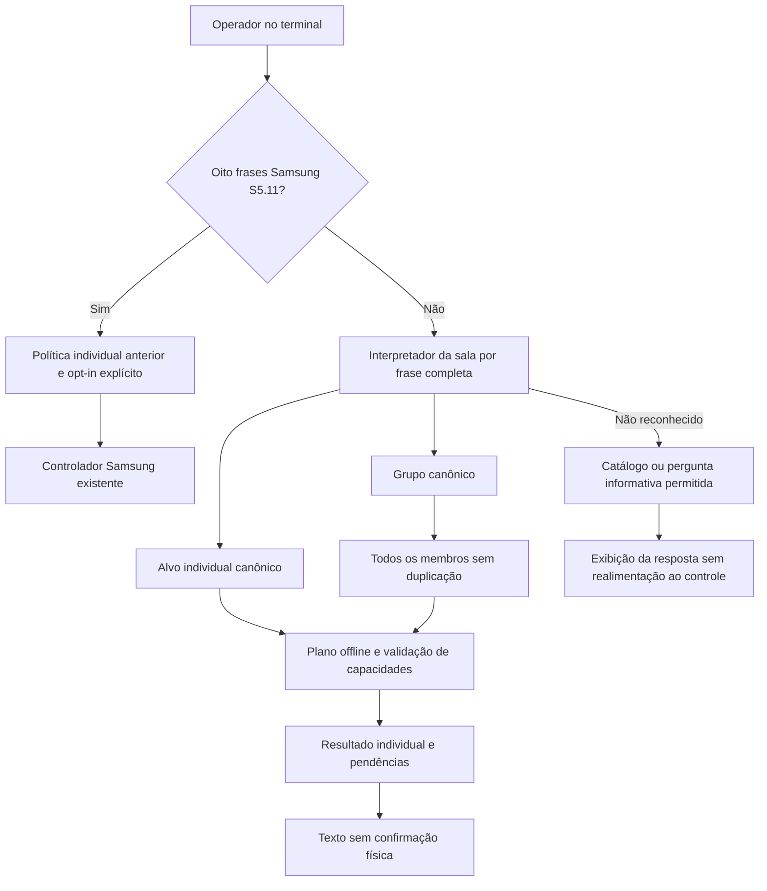

# Dispositivos, grupos e conversa contínua

Grupos canônicos: **monitores**, **leds**, **audio**. Toda TV é um monitor.
“Todas as TVs” é alias do grupo `monitores`, sem segundo conjunto físico.
`resolve_group()` inclui todos os IDs cadastrados, sem duplicá-los por alias,
e não oculta integrantes planejados ou ainda sem capacidade de atuação.

## Comandos cadastrados

| Tipo | Exemplos | Alvo |
| --- | --- | --- |
| Individual | Ligue a TV Samsung / Ligue a televisão Samsung / Ligue o monitor Samsung | `samsung_lab_tv` |
| Individual | Ligue o monitor Jarvis | `jarvis_interface_display` |
| Individual | Desligue o monitor do dashboard | `second_display_placeholder` |
| Individual | Ligue os LEDs do perímetro | `led_perimeter` |
| Individual | Desligue o áudio da sala | `room_audio` |
| Grupo | Ligue os monitores / Desligue todos os monitores / Ligue todas as TVs | `monitores` |
| Grupo | Ligue os LEDs / Desligue as luzes LED | `leds` |
| Grupo | Ligue o sistema de áudio / Desligue os alto-falantes | `audio` |
| Cena | Ativar modo apresentação / Ative o modo apresentação | `modo_apresentacao` |
| Cena | Encerrar apresentação / Desative o modo apresentação | `encerrar_apresentacao` |

Os verbos `ligue` e `desligue` aceitam os aliases completos cadastrados. Prefixo
Jarvis opcional, caixa e acentos normalizados; `.`, `!`, `?` finais e vírgula após
Jarvis são permitidos. O hífen é aceito somente no substantivo `alto-falantes`.
Não há correspondência parcial. São bloqueados negação, múltiplas ações,
condição, agenda, prompt injection, IDs/serviços/URLs e alvos desconhecidos.
Um sensor conhecido não ganha capacidade de ligar ou desligar.

“Desligue os alto-falantes” identifica o grupo `audio`, atualmente com um cadastro
lógico do sistema de som. Não representa descoberta do número de caixas físicas.
O alias individual desse mesmo cadastro é “o áudio da sala” ou “o equipamento de
áudio”; não se duplica equipamento porque uma frase é coletiva.

## Uso offline

Na raiz do repositório, iniciar a sessão sem flags de execução:

```bash
PYTHONPATH=projects/jarvis-room/src python3.11 -m jarvis_room.room_session_cli
```

Digite os exemplos acima e `sair`. As respostas descrevem o plano, cada alvo e
integrações pendentes, sem enviar comando físico. São também consultas exatas:

- “Quais são os grupos da sala?” ou “Liste os grupos da sala”.
- “Quais são os dispositivos da sala?” ou “Liste os dispositivos da sala”.
- “Mostre o inventário da sala”.

Para obter um JSON de planejamento sem sessão/TTY:

```bash
PYTHONPATH=projects/jarvis-room/src python3.11 -m jarvis_room.room_orchestrator \
  'Jarvis, ligue os monitores.'
```

Essa CLI só oferece preview; não existe opção de token, URL, backend ou execução.
O `FakeRoomBackend` existe exclusivamente em testes, nunca como backend padrão.
O resultado é `offline_preview/plan_ready`, sem alegação de que equipamentos
tenham ligado. A API de simulação usa outro contrato, `RoomSimulationBackend`.

## Fronteira Samsung S5.11

As oito frases originais de TV/televisão com/sem Samsung preservam sua prioridade
na sessão. Sem `--enable-samsung`, continuam bloqueadas para controle físico;
com essa opção e arquivos/TTY válidos, continuam usando exatamente a política,
auditoria e controlador anteriores. Esse caminho não foi acionado fisicamente
na Sprint 6; testes usam somente REST falso.

**Novo alias “monitor Samsung”, comandos coletivos e cenas ficam offline mesmo
com `--enable-samsung`.** Reconhecer a mesma identidade não significa ampliar
uma autorização já homologada. Não se reescreve o texto digitado para fabricar
uma frase Samsung válida na política antiga. Uma futura homologação pode revisar
essa política explicitamente; permissões individuais não concedem escopo de sala.

`--llm` continua opcional para perguntas informativas, com configuração e memória
restritivas. Respostas do modelo são apenas exibidas, nunca reprocessadas como
intenção, consulta, plano ou credencial. O ramo novo não recebe cliente/token,
sessão ou permissão Samsung. Comando desconhecido não encerra a conversa.
`sair`, EOF e Ctrl+C preservam a revogação da sessão S5.11. Não há voz/microfone.

## Fluxo de comandos



Próximos passos e cenas: [modo apresentação](room-presentation-scenes.md).
