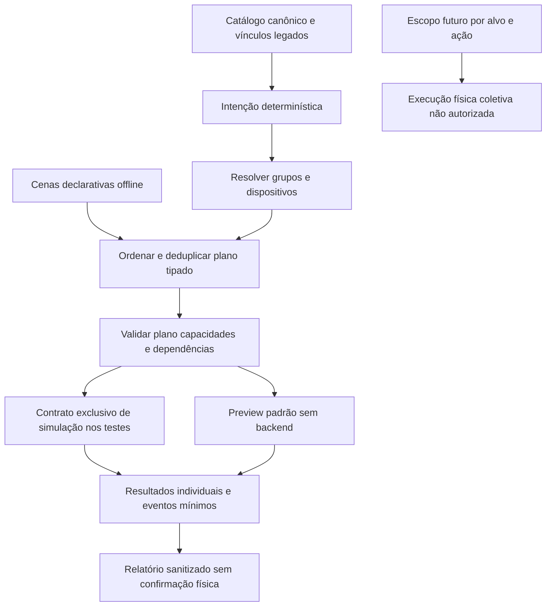
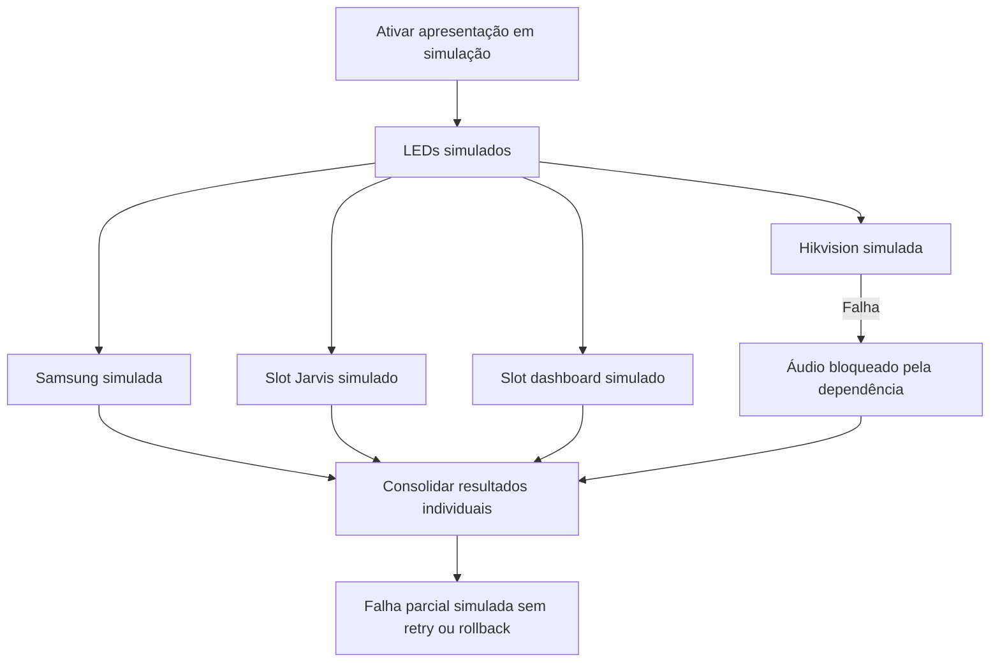

# Modo apresentação — planos e simulação

`config/room_scenes.json` define duas cenas; `room_scenes.py` valida e expande
os passos em um `ExecutionPlan` imutável antes de qualquer backend. A execução
padrão é exclusivamente offline. O orquestrador não registra clientes físicos.

## Sequências

Ativação (`modo_apresentacao`, `activate`):

1. Ligar o grupo `leds`.
2. Ligar cada integrante do grupo `monitores`, depois dos LEDs.
3. Ligar o grupo `audio`, depois de todos os monitores.

O plano atual contém seis IDs: um sistema LED, quatro registros de exibição
(incluindo dois papéis ainda sem equipamento atribuído) e um sistema de áudio.
“Preparar áudio” é requisito futuro de integração, não uma ação física inventada;
a única capacidade planejada usada aqui é `turn_on`.

Encerramento (`encerrar_apresentacao`, `deactivate`):

1. Desligar áudio.
2. Desligar monitores.
3. Desligar LEDs.

Somente alvos cadastrados de exibição, LED e áudio participam desse plano.
Nenhum computador, processo Jarvis, controlador ou serviço de segurança é alvo.
Essa sequência é uma proposta declarativa testada offline; não é homologação
elétrica ou operacional de uma sequência física.

## Validação e falhas

O JSON tem versão/tipos/campos exatos, rejeita chaves duplicadas e permite apenas
ações `turn_on`/`turn_off` coerentes com ativação/encerramento. Targets são IDs de
dispositivos/grupos conhecidos; dependências devem existir e ser acíclicas.
Referências a serviços, endpoints e computadores não são aceitas.

Grupos são expandidos para IDs concretos e ações repetidas sobre o mesmo ID são
deduplicadas. Dependências são reunidas; se a expansão causar ciclo, o plano é
recusado antes de qualquer ação. Capacidades não suportadas são identificadas
por alvo. `execution_available` continua falso; integração planejada não se torna
real porque a cena possui uma ação declarada.

O backend de simulação só tem `simulate_step(device, action)`, metadados fixos de
simulação e observações tipadas com estado restrito. É injetado em testes; não é
selecionado por JSON ou texto de LLM. O orquestrador reconstitui o plano para
detectar adulteração antes de chamá-lo. Não aceita `ToolReceipt` como observação
simulada nem produz um recibo de sucesso físico.

Se um passo falhar, dependentes recebem `blocked_dependency`; outros membros
independentes ainda têm seu resultado individual. Todos os alvos permanecem no
relatório. Não há retry nem rollback. Um backend indisponível gera código
sanitizado; mensagens internas não são incluídas no relatório.

Estados `unknown`, `unavailable` ou diferentes do alvo não são match. Uma simulação
completa retorna `simulated_complete`, uma parcialmente bem-sucedida retorna
`simulated_partial`; sem matches, `simulated_failed`. Nenhum desses valores
significa que a sala funcionou fisicamente. Preview retorna `plan_ready` e
expõe `pending_integration` ou `lab_integration_available`, sem consultar o HA.

`RoomExecutionResult` contém resultados por ID, eventos mínimos correlacionados
e tempo transcorrido. Os eventos ficam em memória; não armazenam diálogos,
credenciais ou detalhes internos de erro. Auditoria persistente de ações físicas
Samsung continua exclusivamente no controlador anterior. Flags de confirmação
continuam falsas em resultado, itens e eventos.

## Arquitetura





## Autorização futura e homologação

`FutureAuthorizationScope` enumera `(device_id, action)` do plano e sempre tem
`physical_execution_authorized=false`. Não é lease nem credencial aceita pelo
controlador Samsung. Permissão individual Samsung não é backend ou escopo para
outros dispositivos. Antes de habilitar operações coletivas, será necessário:

- Resolver identidade física dos slots e comprovar cada integração/protocolo.
- Dimensionar e revisar instalação WS2815 com profissional habilitado.
- Identificar áudio, métodos seguros, estados e sequência física de operação.
- Autorizar cada alvo/ação com expiração, revogação e consumo controlado.
- Revisar preflight, isolamento de falhas, auditoria e critérios de confirmação.
- Homologar grupos e cenas especificamente, com observador e autorização humana.

Metadados de simulação não são sandbox contra código Python malicioso no mesmo
processo. Não há driver físico novo, chamada de rede ou ferramenta de LLM nesta
implementação. Voz e microfone exigem outra decisão de segurança.

```bash
PYTHONPATH=projects/jarvis-room/src python3.11 -m jarvis_room.room_orchestrator \
  'Jarvis, ativar modo apresentação.'
PYTHONPATH=projects/jarvis-room/src python3.11 -m jarvis_room.room_orchestrator \
  'Jarvis, encerrar apresentação.'
```

Esses comandos geram JSON offline, sem token ou POST.
