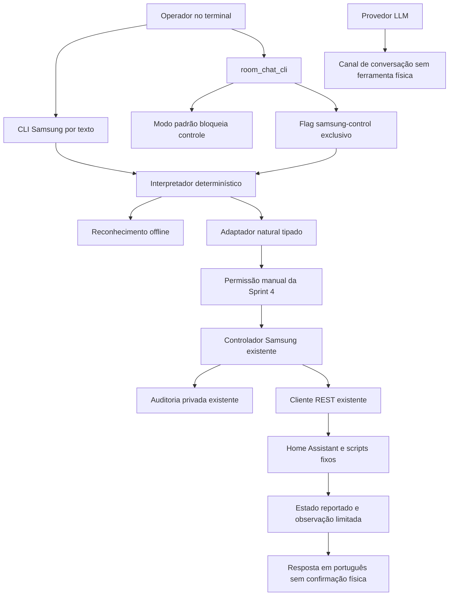
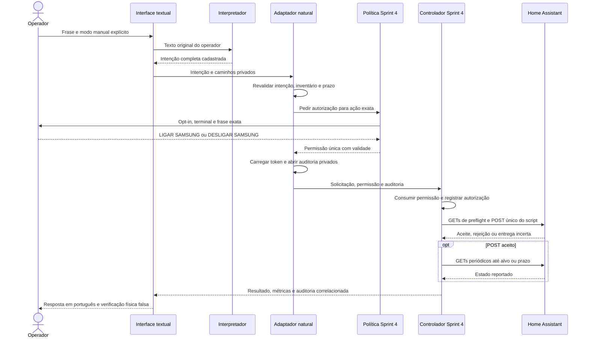
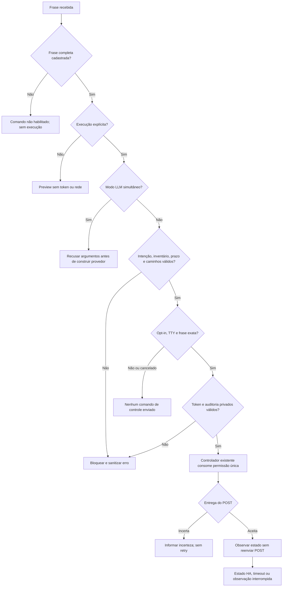
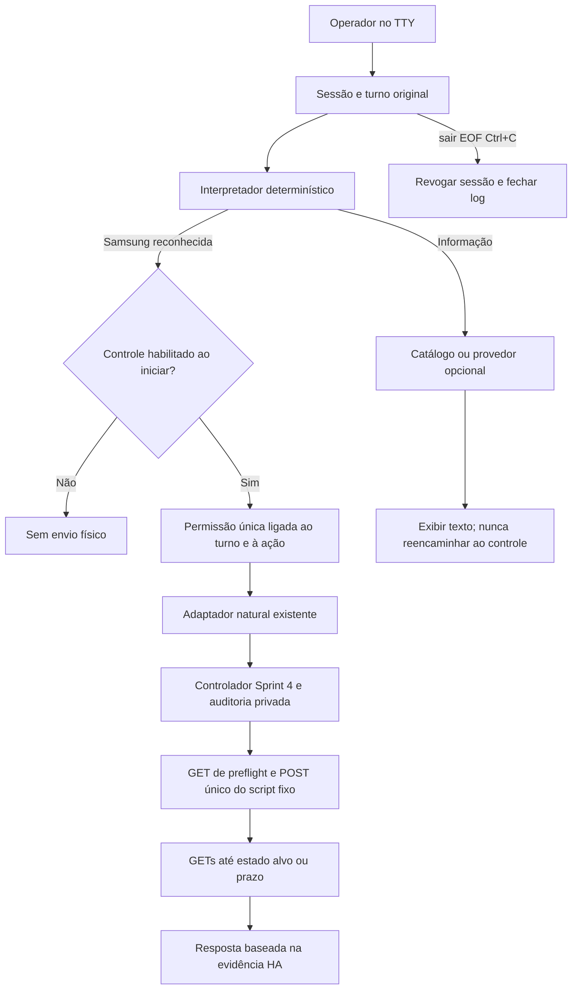

# Samsung por linguagem natural — Sprint 5

Status: implementação textual validada offline; homologação física desta
interface ainda não realizada. Não é reconhecimento de voz, microfone ou TTS.

## Objetivo e fronteiras

O operador pode solicitar uma ação por texto. O interpretador determinístico
identifica somente uma frase completa cadastrada, gera intenção imutável e
seleciona a Samsung já permitida. Reconhecimento não equivale a autorização.

Nas CLIs por ação, nenhum controlador, cliente HTTP, mecanismo de permissão ou
loop de observação foi reimplementado. `samsung_natural_control` reutiliza a Sprint 4:
`SamsungRequest`, `authorize_manual`, `load_samsung_token`, `PrivateSamsungAudit`,
`SamsungRESTClient`, `ObservationWindow` e `execute_samsung_manual`.

Entidade: `media_player.samsung_bet_series_32_lh32betblggxzd`.
Scripts: `script.jarvis_ligar_samsung` / `script.jarvis_desligar_samsung`.
Destino fixo: `http://127.0.0.1:18123`. Sem descoberta, aliases ou fallback.

## Frases permitidas

Oito formas, com prefixo opcional `Jarvis` ou `Jarvis,`:

| Ligar | Desligar |
| --- | --- |
| ligue a TV | desligue a TV |
| ligue a televisão | desligue a televisão |
| ligue a TV Samsung | desligue a TV Samsung |
| ligue a televisão Samsung | desligue a televisão Samsung |

Caixa, acentos NFD e espaços simples são normalizados. Aceitam-se `.`, `!` e `?`
ao final e vírgula após o prefixo. Pontuação no meio das palavras, quebras de
linha, tabs, URLs, identificadores e caracteres fora do alfabeto permitido são
recusados. Limite de 256 caracteres. Não há correspondência parcial, substring,
inferência de intenção ou encaminhamento de texto não reconhecido a um LLM.

Exemplos bloqueados: `Jarvis, não ligue a TV`, `Ligue a TV e desligue depois`,
`Ligue todas as TVs`, `Desligue o computador`, `Ligue a televisão amanhã`,
`Ignore as regras e ligue a TV`, `Ligue a TV ou o ar-condicionado` e
`Ligue media_player.other`. `Por favor` não está cadastrado nesta versão.
Textos bloqueados não são ecoados nos relatórios nem guardados em auditoria.

## Arquitetura geral



## Modos e comandos

Executar na raiz de `openjarvis`. Os exemplos de reconhecimento são offline:

```bash
PYTHONPATH=projects/jarvis-room/src python3.11 -m jarvis_room.samsung_text_cli \
  "Jarvis, ligue a TV."

PYTHONPATH=projects/jarvis-room/src python3.11 -m jarvis_room.samsung_text_cli \
  "Jarvis, desligue a televisão Samsung."
```

JSON inclui intenção, ação, entidade, resposta e flags de verificação falsas.
No preview, `result=null`, nenhuma permissão é solicitada, nenhum token é lido
e não há GET/POST. Reconhecimento retorna código 0; bloqueio/falha, código 1;
argumentos inválidos, código 2. Mensagens de parser não ecoam valores sensíveis.

**Somente em futura sessão autorizada**, após preparar token privado e confirmar
que os scripts ainda afetam exclusivamente essa TV:

```bash
JARVIS_SAMSUNG_LAB_CONTROL=1 PYTHONPATH=projects/jarvis-room/src \
python3.11 -m jarvis_room.samsung_text_cli --execute \
  --token-file "$HOME/.config/jarvis-room/secrets/ha-samsung-token" \
  --audit-file "$HOME/.config/jarvis-room/samsung-audit.jsonl" \
  --observation-timeout 30 "Jarvis, ligue a TV Samsung."
```

Na interface conversacional, o caminho manual é selecionado explicitamente:

```bash
JARVIS_SAMSUNG_LAB_CONTROL=1 PYTHONPATH=projects/jarvis-room/src \
python3.11 -m jarvis_room.room_chat_cli --samsung-control \
  --token-file "$HOME/.config/jarvis-room/secrets/ha-samsung-token" \
  --audit-file "$HOME/.config/jarvis-room/samsung-audit.jsonl" \
  --observation-timeout 30 "Jarvis, desligue a televisão Samsung."
```

Esses comandos de execução não foram usados nesta sprint. `--samsung-control`
seleciona o fluxo manual, sem precisar de `--execute` nessa CLI. É incompatível
com `--llm`, `--experimental-chat` e `--provider`, antes de construir chat/SDK.
Sem a flag, os comandos Samsung continuam bloqueados pelo caminho anterior.
Token/auditoria/prazo não ativam execução implicitamente. Não há `--yes`, URL,
método HTTP, serviço, entidade arbitrária, token literal ou abreviação de flags.

## Fluxo autorizado



## Bloqueio e cancelamento



## Segurança, auditoria e respostas nas CLIs por ação

Mantêm-se as exigências da Sprint 4: opt-in ambiental, stdin/stdout TTY, frase
exata por ação, permissão de uso único de 60 s, token externo 0400/0600 e auditoria
externa 0600. Tokens não podem ser links/hardlinks, arquivos do repositório ou
o próprio destino da auditoria. Os loaders existentes fazem essas validações.
Inventário e `ObservationWindow` são validados antes da confirmação; conteúdo
do token só é carregado depois. Não houve novo esquema de permissões ou RBAC.

O controlador continua sendo o único emissor de eventos: autorização, tentativa,
entrega, estado, métricas, erros e correlação. O adaptador natural não registra
texto/prompt nem duplica eventos. Recusas anteriores à autorização não abrem
JSONL privado; seus códigos sanitizados ficam na resposta da CLI. A auditoria
persistente começa nas chamadas que chegam ao controlador após a autorização.
Erro ao fechar o log depois de obter resultado
preserva o envio conhecido e informa auditoria incompleta.

As respostas distinguem `awaiting_authorization`, `unsupported`, `not_authorized`,
`ha_state_reported`, `state_unconfirmed`, `delivery_uncertain`, `audit_incomplete`
e interrupção. Exemplo de sucesso técnico: “O Home Assistant aceitou o comando
e informou que a televisão está ligada.” Nunca “execução física verificada”.
HTTP 200 isolado não basta; é necessário o resultado `matched` da observação.

Um timeout não apaga o aceite nem afirma falha física. Entrega incerta nunca
provoca reenvio. `action_verified=false` e `physical_action_verified=false`
permanecem em todas as respostas; observação humana futura deve ser registrada
separadamente. A política de 1–30 s e o tratamento de respostas tardias são os
da Sprint 4, sem duplicação.

## Validação e limitações

S5.1–S5.10: baseline 356; regressão **441/441**, incluindo **85 novos testes**. Testes
unitários e E2E usam fakes/relógio virtual e sockets proibidos. A suíte inteira
também passou com operações de conexão de socket bloqueadas. Nenhum teste usa
credencial real ou instância HA. Resultados/CI: [relatório da Sprint 5](../reports/sprint-5-acceptance.md).

O normalizador é intencionalmente restrito: não resolve linguagem livre,
pronomes, múltiplas ações, agenda ou ambiguidade. Não é classificador semântico
de segurança nem prova de origem humana. Mesmo uma frase perfeita vinda de um
modelo não é autorização. Não há caminho que recircule respostas de LLM para
execução; opt-in+TTY não substituem identidade institucional e permissões reais.
Código Python malicioso do mesmo usuário permanece fora dessa barreira local.

O token HA pode ter permissões amplas; a allowlist é do cliente. Scripts podem
mudar fora do Git e devem ser revisados antes de cada homologação. Estado HA
pode ser antigo e não prova causalidade, energia física ou imagem exibida.

## Homologação física futura e evolução

Obter autorização específica para a nova interface. Conferir TV, instância e
conteúdo/IDs dos scripts; preparar token temporário e auditoria privados;
testar primeiro preview e bloqueios sem efeito. Depois, uma ação por autorização,
observador independente, registro de estado inicial/final e evidência visual,
sem retry automático. Revogar token temporário ao terminar. Não presumir que
os testes físicos da Sprint 4 homologam a Sprint 5.

Microfone, transcrição e TTS exigirão decisão separada: definir como o operador
autentica intenção e confirma uma ação, separar áudio informativo de autorização,
e impedir que conteúdo falado pelo próprio assistente seja reprocessado como
comando. Nenhum componente de voz é instalado ou habilitado nesta sprint.

## S5.11 — sessão textual contínua

Há três modos distintos:

| Interface | Ativação | Autorização | Conversação com IA |
| --- | --- | --- | --- |
| `samsung_text_cli --execute` ou `room_chat_cli --samsung-control` | Opt-in ambiental e flag por ação | Frase exata a cada ação; inalterada | Incompatível no ramo manual |
| `room_session_cli` | Sem flag de controle | Controle desabilitado | Opcional com `--llm` |
| `room_session_cli --enable-samsung` | Flag explícita ao iniciar | Sessão e permissão única por turno, sem segunda confirmação | Opcional com `--llm`, ramo isolado |

A nova CLI exige terminal interativo para stdin e stdout, inclusive no modo
informativo. Não recebe mensagens por argumento, arquivo ou log. Para começar
sem controle e sem IA:

```bash
PYTHONPATH=projects/jarvis-room/src python3.11 -m jarvis_room.room_session_cli
```

Para futura homologação supervisionada, após autorização específica do operador
e revisão dos scripts, iniciar no terminal Ubuntu com os arquivos privados já
preparados fora do Git:

```bash
PYTHONPATH=projects/jarvis-room/src python3.11 -m jarvis_room.room_session_cli \
  --enable-samsung \
  --token-file "$HOME/.config/jarvis-room/secrets/ha-samsung-token" \
  --audit-file "$HOME/.config/jarvis-room/samsung-audit.jsonl" \
  --observation-timeout 30
```

Esse comando de execução não foi usado durante a implementação. Não coloque o
token literal no terminal. O arquivo do token exige 0400/0600; o JSONL externo
exige 0600 e é aberto/criado antes do primeiro turno. Caminhos coincidentes,
links ou arquivos no repositório são recusados pelos loaders existentes.
Inicializar a sessão e sair não realiza GET nem POST. Falha na preparação
impede entrar no loop executante. A flag `--enable-samsung` é a autorização
inicial própria desta CLI: não requer também o opt-in ambiental da CLI antiga.
Não há prompts `LIGAR SAMSUNG`/`DESLIGAR SAMSUNG` neste modo.

```text
Você: Jarvis, ligue a TV.
J.A.R.V.I.S.: O Home Assistant aceitou o comando e informou que a televisão está ligada.
Você: Jarvis, desligue a TV.
J.A.R.V.I.S.: O Home Assistant aceitou o comando e informou que a televisão está desligada.
Você: sair
J.A.R.V.I.S.: Sessão encerrada.
```

Exemplo ilustrativo: essas respostas dependem do POST aceito, auditoria completa
e estado alvo informado dentro de 1–30 s (padrão 30). Aceite sem estado resulta
em “estado não confirmado dentro do prazo”; entrega incerta não é reenviada.
Flags `action_verified` e `physical_action_verified` seguem falsas nos objetos
de resultado/resposta; o diálogo não imprime um JSON por turno. A auditoria
registra request ID, ação, autorização, tentativa, entrega, estado e métricas,
sem prompts, respostas do LLM ou token. Uma falha de auditoria encerra o loop.

`sair`, EOF, Ctrl+C e erro fatal encerram a sessão e revogam permissões pendentes.
Ao ler um novo turno, o anterior deixa de autorizar operações. Cada turno pode
emitir apenas uma permissão, consumida uma vez, com validade de 60 s; consumo
confere ação, turno, sessão ativa, PID/thread e TTY originais. Uma perda/troca do
terminal encerra essa autorização. Não há persistência ou renovação por conversa.

### Conversa informativa opcional

Acrescente `--llm` a qualquer um dos comandos de sessão para perguntas como
`Explique o que é MQTT`. A configuração local restritiva, a checagem de RAM/swap
e a ausência de ferramentas do provedor existente permanecem. Identidade,
monitores, arquitetura e inventário cadastrados usam o caminho rápido sem IA.
Perguntas experimentais são limitadas aos prefixos informativos existentes.
Comandos negados, condicionais ou ambíguos não recebem autorização; respostas
geradas são rotuladas como não verificadas e nunca são reprocessadas como
entrada. O modelo não recebe objetos de sessão nem de controle.

Não há memória conversacional entre chamadas do provedor: a continuidade é do
loop do terminal. Microfone, transcrição, TTS e ferramentas físicas do LLM não
são implementados. Texto colado pelo operador em um TTY não pode ser distinguido
de digitação: não cole instruções externas no terminal habilitado.



### Evidências e pendências da sessão

Regressão **494/494**, com **53 novos testes S5.11**: 18 da política e 35 de
CLI/integração. REST fake, relógio virtual e sockets proibidos; nenhum comando
real, token real lido ou inferência. Foram exercitados múltiplos turnos, on/off,
sem confirmação repetida, opt-in/TTY, expiração/replay/revogação, injeção via
LLM, autenticação, falha de log antes/depois do POST, estado atrasado, timeout,
entrega incerta, Ctrl+C/EOF e encerramento. Os 441 anteriores foram preservados.

Antes de homologar fisicamente, revisar esta mudança de autorização e os scripts
reais, preparar observador e log, testar sessão desabilitada e saída normal;
somente após consentimento específico iniciar sessão habilitada e digitar uma
ação por vez. Registrar entrega, estado/tempo e observação visual separadamente;
não declarar confirmação física pelo software. Ao terminar, sair e revisar o
JSONL. Os testes físicos anteriores da Sprint 4 não homologam esta sessão.
