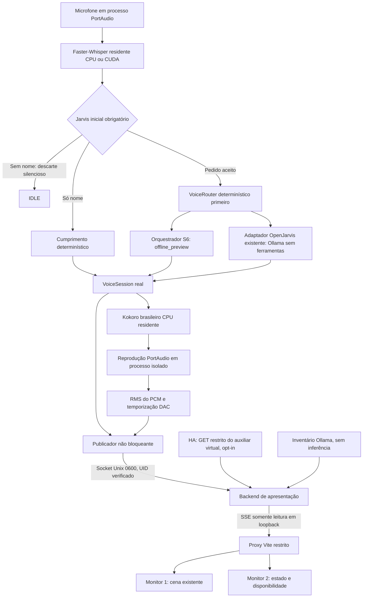
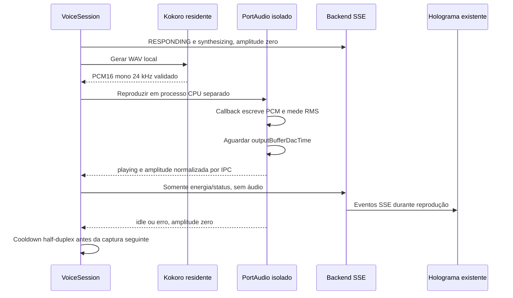

# Voz e apresentação local — Sprints 9, 9.1 e 9.2

Integração da sessão S7 com as telas S8, sem controle físico por voz ou navegador.
[Registro original S9](../reports/sprint-9-acceptance.md).
[Consolidação LIVE S9.2 e resultados](../reports/sprint-9-2-acceptance.md).
[Contrato v2](presentation-events.md).
[Operação atual S9.1: vocativo obrigatório e pm_alex](jarvis-wake-persona.md).
[Controles supervisionados futuros](supervised-physical-automation.md).

## Arquitetura



Só há uma CLI de voz. Abrir duas janelas não cria modelos, captura, LLM ou TTS.
O backend de apresentação não inicia a sessão nem importa modelos pesados.
Ele observa serviços e distribui eventos; não oferece comandos, terminal ou
publicação HTTP. O navegador não acessa HA/Ollama diretamente.

## Iniciar os três componentes

Da raiz `openjarvis`, com o ambiente virtual existente:

```bash
export PYTHONPATH=projects/jarvis-room/src:src
```

Terminal 1, backend de apresentação (não grava nem gera respostas):

```bash
.venv/bin/python -m jarvis_room.presentation_server
```

Terminal 2, frontend:

```bash
cd projects/jarvis-room/frontend
npm run dev
```

Abra simultaneamente:

- `http://127.0.0.1:5174/monitor/1`
- `http://127.0.0.1:5174/monitor/2`

As duas rotas iniciam automaticamente em **LIVE**. Não é preciso trocar a
fonte ou recarregar páginas para receber estados. Sem backend, exibem
**Desconectado · reconectando**, sem fallback para simulação. DEMO exige
seleção explícita em **Controles** (ou D), **Fonte de dados**, **DEMO**.
LIVE começa desconhecido e só mostra conexão após handshake v2 válido.

Terminal 3, **etapa humana supervisionada de voz**, da raiz do repositório:

```bash
PYTHONPATH=projects/jarvis-room/src:src .venv/bin/python -m jarvis_room.room_voice_cli \
  --stt-model-dir "$HOME/.local/share/jarvis-room/models/whisper-large-v3-turbo" \
  --stt-device cuda --stt-compute-type float16 \
  --llm --llm-model qwen3.5:4b --tts-backend none --presentation --metrics
```

Enter ativa a janela. Aguarde o aviso de microfone efetivamente aberto. Continue
os turnos começando sempre com Jarvis; STT permanece residente. Ctrl+C/EOF encerra a CLI;
Ctrl+C no terminal 1 encerra o backend e remove apenas seu próprio socket.
SIGTERM também encerra o backend. Não iniciar várias CLIs de voz por monitor.

CPU continua disponível com `--stt-device cpu --stt-compute-type int8` e um
modelo local adequado. Não há download nem mudança automática de precisão.
A política de contexto/memória S7 permanece: quatro pares/1800 caracteres,
prompt 3800, saída 192 tokens e contexto 4096 por padrão. Modelo instalado
Qwen 3.5 4B; disponibilidade não certifica respostas nem coexistência na GPU.
O inventário agora publica modelo instalado com uso não observado. Somente
`router_complete` de resposta informativa confirma geração, antes do TTS;
o polling do inventário não substitui essa evidência nem seu horário.

## Portas, origem e IPC

| Recurso | Destino | Restrição |
| --- | --- | --- |
| Frontend | `127.0.0.1:5174` | Servidor de desenvolvimento local |
| SSE | `127.0.0.1:8765/events` | Apenas GET, sem CORS aberto ou rota de publicação |
| Proxy do navegador | `/api/presentation/events` | Só esse caminho exato vai ao SSE |
| Publicação Python | `/tmp/jarvis-presentation-UID/events.sock` | Diretório 0700, socket 0600, SO_PEERCRED do mesmo UID |
| Ollama existente | `127.0.0.1:11434` | Inventário GET e adaptador informativo existente |
| HA laboratório | `127.0.0.1:18123` | Somente GET autorizado do auxiliar virtual |

Host HTTP precisa ser `127.0.0.1:PORTA`. Origem, quando enviada, precisa ser
`http://127.0.0.1:5174`; `Sec-Fetch-Site=cross-site` é rejeitado. O navegador usa
o proxy de mesma origem, sem receber segredo. Não existe endpoint HTTP de
publicação, execução ou conversa de entrada. Métodos de escrita não são atendidos.

O UID autentica o processo Unix como pertencente ao usuário local, não como
identidade do operador. Código malicioso sob esse mesmo UID pode falsificar
apresentação, mas não recebe execução física. Loopback/origem não autenticam
clientes locais de leitura: habilite conteúdo pessoal apenas num ambiente local
confiável. Não compartilhar credenciais na conversa.

Um produtor por backend, até seis assinantes SSE, oito handlers HTTP e dois
handlers Unix. Mensagens Unix limitadas a 8192 bytes; filas publicador/assinante
de 64/128 eventos. Consumidor lento é desconectado, sem atrasar áudio.
Sessão/época UUID e sequência segura crescente; reconexão recebe snapshot atual,
descarta dados anteriores e ignora callbacks de transportes encerrados.
Heartbeat SSE a cada 2 s; frontend invalida após 8 s sem heartbeat. Lease do
produtor expira após 6 s sem mensagem, verificada a cada 250 ms. Um produtor
antigo não pode encerrar o lease do substituto.

Socket existente não é apagado automaticamente na inicialização. Se um processo
for morto abruptamente e deixar um socket, confirme primeiro que não há backend
ativo e inspecione proprietário/permissões antes de qualquer remoção manual.
`--socket /CAMINHO/PRIVADO/events.sock` e `--presentation-socket` precisam coincidir;
o diretório deve pertencer ao usuário e ter 0700. O proxy usa a porta padrão 8765.

## TTS e pulsação

Na auditoria original S9 faltavam Kokoro/Torch e assets. Na conferência
S9.1 eles estão presentes no Lief: Kokoro 0.9.4, Torch 2.14.1+cpu,
config/pesos e tensores pm_alex/pm_santa locais. A presença foi verificada
sem síntese/reprodução. A nova voz padrão é **pm_alex**, pipeline brasileiro
`p`, velocidade 0,92 e volume 0,5. A audição da nova configuração está pendente.
Não houve downloads ou instalações nesta implementação.

Depois de preparar dependências e arquivos, a sessão supervisionada com TTS é:

```bash
PYTHONPATH=projects/jarvis-room/src:src .venv/bin/python -m jarvis_room.room_voice_cli \
  --stt-model-dir "$HOME/.local/share/jarvis-room/models/whisper-large-v3-turbo" \
  --stt-device cuda --stt-compute-type float16 \
  --llm --llm-model qwen3.5:4b --presentation \
  --tts-backend kokoro --tts-model-dir "$HOME/.local/share/jarvis-room/models/kokoro" \
  --voice pm_alex --speed 0.92 --volume 0.5 --metrics
```

`tts_prerequisites` verifica pacotes, espeak e arquivos sem carregar modelo.
Ausência de dependência preserva texto e disponibilidade negativa no dashboard.
Configuração, pesos e tensor de voz devem estar completos/localmente presentes.
Velocidade 0,5–2, volume 0–1; dispositivo via `--output-device N` após diagnóstico.
O nome escrito J.A.R.V.I.S. é preparado como Jarvis somente para TTS.
Cada pedido de voz exige Jarvis inicial. Para o modo sem Enter, consulte o
[guia experimental completo](jarvis-wake-persona.md).
Somente abrir a saída confirma que é utilizável; arquivo existente não comprova
síntese válida. Falhas de modelo/dispositivo têm fallback sem indicar fala ativa.



Callback de saída a 24 kHz, blocos de 960 amostras (40 ms). Volume é aplicado
antes do RMS; RMS/32768 normaliza em 0–1. Filtro de ataque 0,65/liberação 0,25
suaviza os valores. O callback escreve numa fila limitada, nunca em rede/pipe.
O loop principal agenda cada valor pelo tempo DAC informado pelo PortAudio.
Não publica a animação toda durante síntese. Finalização espera drenagem da
saída; cancelamento/erro força zero, inclusive no supervisor que mata o worker.

O worker de reprodução reaproveita o protocolo enquadrado da S7, com respostas
intermediárias tipadas e mesmo ID, seguido do resultado final. É CPU, separado
de STT/Kokoro e supervisionado por timeout/cancelamento/parent-death guard.
O quadro privado também leva tempo monotônico: progresso playing/energia
positiva com atraso superior a 500 ms no pipe é descartado pelo supervisor;
fim/zero continuam sendo entregues. Esse campo não é publicado ao navegador.
Half-duplex permanece: captura e detector fechados durante síntese/reprodução,
cooldown padrão 0,8 s, nova fila na próxima captura. Não há interrupção por voz.

Em LIVE, `RESPONDING` significa preparar/responder; só `playback_status=playing`
permite energia positiva e indicação de fala real. `synthesizing`, indisponível
ou erro não simulam pulsação. Frontend zera energia sem progresso por 500 ms
(watchdog de 250 ms); backend usa limiar de 750 ms (verificação de 250 ms).
Eventos de energia com timestamp mais de 1,5 s fora do relógio local são rejeitados.
Os relógios WSL/Windows precisam estar coerentes. O áudio passa ainda por buffers
do Windows/WSLg: sincronização perceptiva/jitter exigem homologação, sem promessa
de precisão acústica absoluta.

A cena mantém núcleo, anéis, partículas, fundo e suavização existentes. O núcleo,
escala e brilho recebem a energia real pela mesma prop usada pela S8. Movimento
reduzido e qualidade visual continuam respeitados. O modo SVG de compatibilidade
não certifica a animação WebGL da sala.

## Conversa opcional no Monitor 2

Nada é compartilhado por padrão. Acrescente **`--share-conversation`** à CLI com
`--presentation` e, no Monitor 2, marque **Mostrar conteúdo compartilhado pelo
operador**. Apenas pares informativos são publicados: pergunta até 256,
resposta até 700 caracteres. Planos físicos não são enviados como conversa.
Renderização usa texto React, sem HTML executável. Conteúdo nunca retorna ao
interpretador. O snapshot guarda somente o último par em memória e é apagado
na desconexão/troca de sessão. Não há histórico persistente ou entrada de texto
pelo navegador; continue usando a CLI para conversar.

## Home Assistant: opt-in somente leitura

Por padrão não há GET HA. Para uma homologação autorizada, forneça um arquivo
privado já preparado, fora do repositório, proprietário correto e 0400/0600:

```bash
JARVIS_HA_LAB_READ=1 PYTHONPATH=projects/jarvis-room/src:src \
  .venv/bin/python -m jarvis_room.presentation_server \
  --read-lab --ha-token-file "$HOME/.config/jarvis-room/ha-lab.token"
```

Reutiliza `HALabReadOnlyClient` e validação do arquivo S3. Entidade exata
`input_boolean.jarvis_lab_light`, timeout GET 2 s, leitura a cada ciclo de 5 s.
Não há redirects/proxies, POST ou chamadas de serviço. Token fica no processo
Python e nunca é publicado. O token HA pode possuir permissões amplas; o cliente
é que restringe a operação a GET.

Esse auxiliar é **virtual**, separado da iluminação física. Não promove
`room_main_lights` a conectado, não comprova estado elétrico e não reutiliza as
entidades Samsung antigas. Catálogo e cenas continuam os JSON canônicos; todos
os planejados permanecem planejados e a Samsung fica sem observação atual.
Não se publicam temperatura, presença ou consumo inventados.

## Diagnóstico e homologação

```bash
PYTHONPATH=projects/jarvis-room/src:src .venv/bin/python -m jarvis_room.room_voice_cli --diagnose
PYTHONPATH=projects/jarvis-room/src:src .venv/bin/python -m jarvis_room.room_voice_cli --diagnose-ollama
```

Diagnóstico não grava, sintetiza ou gera respostas. No backend, sem sessão de
voz, `voice/stt/tts=unavailable` é esperado. Ollama/modelo conectado significa
inventário acessível/pacote instalado, não resposta homologada. Cada serviço
traz horário de observação, UTC no evento e fuso do navegador na tela. STT
conectado registra a carga observada; não é inspeção contínua da GPU ociosa.

| Sintoma | Verificação |
| --- | --- |
| LIVE reconectando | Backend em 8765, Vite em 5174, proxy exato e Host/origem |
| Voz desconhecida/indisponível | Uma CLI com `--presentation`, mesmo socket, permissões, erro da sessão |
| Sem energia, RESPONDING | TTS ausente, ainda sintetizando ou falha de saída; não há fala simulada |
| Energia interrompida | Logs sanitizados da CLI, overflow/timeout, atraso SSE e relógios WSL/Windows |
| Ollama indisponível | `--diagnose-ollama`; confirmar serviço e nome instalado, sem pull automático |
| HA sem leitura | Opt-in, arquivo privado, auxiliar existente e autorização de homologação |
| `microphone: capture_limit` | Houve energia interpretada como fala sem pausa suficiente antes do limite; medir entrada conforme abaixo |
| HTTP 504 ao abrir a cena | Pré-bundle configurado dos imports 3D e cache específico do projeto; não apagar arquivos/modelos |

Roteiro humano: diagnosticar; iniciar backend/frontend e selecionar LIVE;
testar voz sem TTS; comparar estados/cancelamento; habilitar Kokoro preparado;
observar início/progresso/fim, silêncio, volume e falha de saída; medir atraso
percebido em fones/alto-falantes, reverberação/eco e conversa de vários turnos;
só depois realizar GET HA com autorização. Nenhum passo concede controle físico.

### Captura descartada por falta de silêncio

`capture_limit` não indica falha de CUDA. O capturador detectou pelo menos três
quadros de energia acima do limiar (500 por padrão), mas não encontrou 1,2 s
consecutivo abaixo dele antes de terminar a captura (15 s por padrão). Ruído,
ganho alto, entrada errada ou fala longa podem causar isso. A frase cortada é
descartada sem STT, LLM ou TTS; o modo contínuo para após a falha para evitar
repetição ilimitada. Aumentar a duração não resolve ruído permanente.

`--diagnose` continua sem abrir streams. A medição abaixo é **outro comando,
opt-in com microfone**, limitado a 1–10 s (padrão 5), sem modelo, transcrição,
publicação SSE ou arquivo de áudio. Usa worker CPU isolado, encerrável por Ctrl+C.
Execute com a sessão de voz encerrada, da raiz do repositório. Primeiro permaneça
em silêncio durante a medição:

```bash
PYTHONPATH=projects/jarvis-room/src:src .venv/bin/python -m jarvis_room.room_voice_cli \
  --measure-input-levels --level-seconds 5 --input-device 0
```

Depois repita e fale normalmente ao aparecer **Microfone aberto**:

```bash
PYTHONPATH=projects/jarvis-room/src:src .venv/bin/python -m jarvis_room.room_voice_cli \
  --measure-input-levels --level-seconds 5 --input-device 0
```

O índice 0 é o dispositivo `pulse` observado no Lief; confirme índices com
`--diagnose` em outro ambiente. O resultado contém RMS mínimo/mediano/p95/máximo
em unidades PCM16, fração de quadros acima do limiar e maior intervalo abaixo
dele. Não são probabilidades de fala. `sampled_seconds` pode ser menor que o
pedido devido ao tempo de abertura do stream. Nenhum quadro recebido gera
`audio_no_frames`, e não um relatório falso de silêncio.

Compare ambiente e fala antes de configurar `--silence-threshold` na sessão.
O limiar deve separar ruído de fala audível; se os níveis se sobrepõem, revisar
microfone/ganho/roteamento no Windows em vez de elevar o limiar às cegas. A
medição não altera ganho, fonte, duração da sessão nem o limiar automaticamente.
No WSLg, `RDPSource` é a entrada esperada; `RDPSink.monitor` captura a saída.
O teste humano continua necessário e nenhuma medição deve ser chamada de
detector acústico de Jarvis.

## Testes reproduzíveis

```bash
python3.11 projects/jarvis-room/scripts/run_offline_tests.py
git diff --check
cd projects/jarvis-room/frontend
npm test
npm run build
npm run test:e2e
```

E2E requer Chromium e bibliotecas de navegador. Nesta entrega foram preparados
somente em `/tmp`; não se instalaram pacotes do sistema. Reprodução dessa opção:

```bash
PLAYWRIGHT_BROWSERS_PATH=/tmp/jarvis-s9-playwright \
  ./node_modules/.bin/playwright install chromium --only-shell
# Se libnspr4/libnss3 faltarem, preparar bibliotecas de teste explicitamente.
LD_LIBRARY_PATH=/tmp/jarvis-s9-browser-libs/extracted/usr/lib/x86_64-linux-gnu \
  PLAYWRIGHT_BROWSERS_PATH=/tmp/jarvis-s9-playwright npm run test:e2e
```

O último comando usa as bibliotecas temporárias já preparadas nesta sessão;
não é requisito da aplicação. Em outro ambiente, seguir a preparação do
Playwright. Os testes usam SSE/áudio/LLM/HA falsos, sem GPU e sem rede externa.
O servidor Vite local serve apenas a UI. Testes não homologam dispositivos,
qualidade de voz, GPU ou latência perceptiva.

Preparação temporária das duas bibliotecas faltantes usada nesta máquina, sem
sudo e sem instalar pacotes no sistema (download explícito de ferramentas de teste):

```bash
mkdir -p /tmp/jarvis-s9-browser-libs
cd /tmp/jarvis-s9-browser-libs
apt-get download libnspr4 libnss3
python3.11 - <<'PY'
from pathlib import Path
import subprocess
root = Path('/tmp/jarvis-s9-browser-libs')
for package in root.glob('*.deb'):
    subprocess.run(['dpkg-deb', '-x', str(package), str(root / 'extracted')], check=True)
PY
```

Depois volte à pasta `projects/jarvis-room/frontend` do repositório para executar
o E2E com os dois prefixos temporários indicados acima. Essa preparação não
altera STT/CUDA, modelos, configuração de áudio ou serviços existentes.

Referências: [SSE](https://developer.mozilla.org/en-US/docs/Web/API/Server-sent_events/Using_server-sent_events),
[RawOutputStream](https://python-sounddevice.readthedocs.io/en/latest/api/raw-streams.html) e
[pré-bundle Vite](https://vite.dev/config/dep-optimization-options.html).


## Consolidação LIVE — Sprint 9.2

[Relatório de implementação e homologação pendente](../reports/sprint-9-2-acceptance.md).
O transporte continua Python → Unix privado → SSE → proxy Vite → React.
Nenhuma API, endpoint de comando ou WebSocket foi adicionado. Cada janela
abre uma assinatura SSE; ambas recebem a mesma época/estado, sem duplicar IA.

### O que cada monitor utiliza

As duas janelas recebem o mesmo contrato v2; os campos visíveis são projeções
somente leitura. Não há subscrição a credenciais/áudio nem consulta HA no React.

| Evento | Monitor 1 | Monitor 2 |
| --- | --- | --- |
| `connection` | Badge LIVE conectado/desconectado | Estado do backend |
| `heartbeat` | Validade da fonte e horário do último evento no tooltip | Validade e última atualização válida |
| `voice_state` | Estado, tradução e cena S8 existente | Estado da sessão |
| `playback_status` | Preparando voz / reprodução / saída inativa | Reprodução e falha explícitas |
| `voice_amplitude` | Energia real para núcleo/anéis/brilho existentes | Amplitude e barras sem envelope simulado em LIVE |
| `service_status` | Recebido, sem painel de serviços | Seis serviços e horário da última observação |
| `device_status` | Recebido, sem promoção física | Inventário canônico; planejados permanecem planejados |
| `lab_observation` | Recebido, sem painel de laboratório | Somente auxiliar virtual autorizado |
| `conversation` | Não exibida | Oculta até opt-in CLI + checkbox; nova sessão/conexão desmarca exibição |

`IDLE` significa espera da sessão; não comprova microfone desligado na escuta
experimental S9.1. O serviço `voice` informa sessão/microfone com detalhe
observado. Não existe telemetria individual do dispositivo de captura no v2:
não inferir estado elétrico ou abertura contínua a partir de IDLE/connected.
O painel explicita que os serviços mostram **última observação**, não garantia
contínua de disponibilidade. Horários incluem dia/mês, evitando confundir uma
observação anterior com uma atual. Não há nova medição de temperatura/presença.

Ollama conectado significa inventário acessível. Modelo instalado é
`service_status(llm, unknown)` com detalhe “instalado; sem resposta observada”.
Uma resposta informativa efetivamente gerada publica `connected` e o nome
selecionado + “resposta gerada nesta sessão”. O rótulo genérico **Observado**
sozinho nunca prova inferência: versões S9 antigas também usavam connected
para inventário. O detalhe/evidência emitido pelo backend diferencia as fases.
Cumprimento fixo, identidade determinística e planos não confirmam uso da LLM.
Falha de inventário remove a evidência atual, e nova conexão exige observação
nova. O dashboard não declara um modelo carregado apenas por estar instalado.

### Validade e retomada

- Heartbeat continua 2 s; timeout 8 s e retry 1 s. Heartbeat/handshake antigo
  ou mais de 8 s no futuro não renovam conexão. Playback/energia fora de 1,5 s
  do relógio local são rejeitados; progresso expira após 500 ms no cliente.
- Snapshot SSE confirma a conexão com timestamp atual, preservando timestamps
  de observações. Antes de assinar, o hub verifica leases de produtor vencidos
  e watchdog de áudio. Cada produtor reconectado cria época nova.
- Reconexão Unix começa em IDLE, reprodução indisponível e energia zero,
  sem reenviar conversa, estados ocupados ou saúde positiva histórica. Nova
  inferência/captura/progresso restaura evidências, sem recarregar Whisper.
- O publicador descarta progresso ocupado/áudio positivo enfileirado há mais
  de 500 ms. Para retomar áudio em andamento exige amostra PCM recente; envia
  playing antes da amplitude e somente restaura RESPONDING se esse estado
  vier do cache da máquina real. Não inventa transição a partir de áudio.
- Erro da sessão invalida energia no publicador, hub e React; erro/fim de TTS
  mantém zero. Primeiro PCM ganha o prazo do watchdog contado do início da
  reprodução, mesmo após longa espera. Relógio DAC/suavização S9 preservados.
- Sem backend/heartbeat, a fonte continua LIVE, limpa observações/conversa/
  energia e tenta reconectar. DEMO permanece isolado. Encerrar uma janela não
  encerra a outra nem a CLI de voz. Cartões do inventário não assinam o fluxo
  de amplitude individualmente; não houve alteração de geometria/assets.

Depois de atualizar os arquivos Python, reinicie manualmente **seus** processos
backend/CLI para carregar o código novo. Não mate processos de terceiros nem
remova sockets em uso. Após reiniciar o backend, as páginas recuperam conexão
sozinhas; a sessão de voz continua residente e reconecta o publicador.

### Três terminais completos com pm_alex

Da raiz `openjarvis`, em terminais independentes. Backend não inicia áudio:

```bash
PYTHONPATH=projects/jarvis-room/src:src .venv/bin/python -m jarvis_room.presentation_server
```

```bash
cd projects/jarvis-room/frontend
npm run dev
```

Sessão de voz para homologação supervisionada:

```bash
PYTHONPATH=projects/jarvis-room/src:src .venv/bin/python -m jarvis_room.room_voice_cli \
  --stt-model-dir "$HOME/.local/share/jarvis-room/models/whisper-large-v3-turbo" \
  --stt-device cuda --stt-compute-type float16 \
  --llm --llm-model qwen3.5:4b \
  --tts-backend kokoro --tts-model-dir "$HOME/.local/share/jarvis-room/models/kokoro" \
  --voice pm_alex --speed 0.92 --volume 0.5 \
  --continuous-experimental --presentation --metrics
```

Abra `http://127.0.0.1:5174/monitor/1` e
`http://127.0.0.1:5174/monitor/2`. Sem a opção contínua, Enter abre a captura
manual. Em qualquer modo cada fala exige Jarvis inicial; Ctrl+C no terminal 3
fecha captura e workers. O backend recebe apenas apresentação, sem execução.
O [guia S9.1](jarvis-wake-persona.md) detalha CPU, dispositivos e comparação de
vozes. Não houve download de pesos nem instalação TTS nesta implementação.

### Aceitação supervisionada no Lief

1. Inicie terminais 1 e 2 e abra as duas rotas: LIVE deve conectar sem seletor.
   Sem CLI, voz/saída ficam não observadas/indisponíveis. Inventário permanece
   declarativo. Confirme que nenhum modelo ou microfone foi iniciado pelas telas.
2. Inicie uma única CLI no terminal 3. Diga `Jarvis` e confira cumprimento fixo,
   RESPONDING, preparação com energia zero e playing/amplitude só durante áudio.
   Se o STT transcrever `J.A.R.V.I.S.`, registre a rejeição conhecida; não afrouxe
   filtro nem faça o frontend contornar a admissão.
3. Diga `Jarvis, quem é você?`; confira os estados e a voz. Para comprovar
   geração Ollama, use também `Jarvis, explique o projeto` (identidade/cumprimento
   podem ser determinísticos). Confira instalado versus resposta gerada no painel.
4. Verifique pulse/core/anéis durante PCM, zero ao final/erro/cancelamento e
   IDLE após resposta. Respeite half-duplex; avalie WSLg/Windows, eco e jitter.
   Esta etapa é auditiva/WebGL real, não é coberta por E2E sem GPU.
5. Feche uma janela: a outra deve continuar atualizando. Reabra: LIVE e snapshot
   atual. Pare **seu** backend pelo Ctrl+C, confirme desconexão/zero nas duas,
   reinicie pelo mesmo comando e confira recuperação sem reload. Modelos não
   devem reinicializar apenas pela reconexão da apresentação.
6. Confirme conversa oculta. Só com `--share-conversation` habilitado na CLI e
   checkbox marcado se mostra texto; desconexão/nova sessão ocultam novamente.
   Falas sem vocativo e ambiente continuam descartadas antes de LLM/TTS.
7. Encerre a CLI: IDLE/energia zero, serviços da sessão sem observação ativa.
   HA continua desabilitado. Uma leitura real futura exige o opt-in e token
   privado já documentados; só o helper virtual, sem ação física.

Registre tempo/resultado observado de cada etapa e se houve hardware, versão,
voz e modelo reais. Este roteiro foi preparado, **não executado com áudio/GPU/HA
reais nesta sprint**. Não se declara nova homologação acústica ou visual real.

### Regressão e portas exclusivas de teste

```bash
python3.11 projects/jarvis-room/scripts/run_offline_tests.py
.venv/bin/ruff check projects/jarvis-room/src/jarvis_room/presentation_*.py \
  projects/jarvis-room/src/jarvis_room/voice_*.py \
  projects/jarvis-room/src/jarvis_room/room_voice_cli.py \
  projects/jarvis-room/tests/test_presentation_*.py \
  projects/jarvis-room/tests/test_voice_*.py \
  projects/jarvis-room/frontend/tests/backend_fixture.py
git diff --check
cd projects/jarvis-room/frontend
npm run typecheck
npm test
npm run build
npm run test:e2e
```

Playwright agora reserva **15174** (Vite `--mode e2e`) e **18765** (backend falso)
no loopback. O modo operacional permanece 5174/8765; não reutiliza servidores
já ativos. O harness inicia/encerra apenas seus filhos. A fixture exige
`JARVIS_PRESENTATION_E2E=1`, não consulta Ollama/HA, não carrega modelos e usa
produtor falso por Unix privado; seu controle é stdin, nunca endpoint HTTP.
Não use esse modo de teste para apresentar dados como telemetria real da sala.
Python 3.11 deve estar no PATH; CI prepara essa versão. Não há dependência de
runtime nova. Pacotes/browsers de teste são separados de modelos de IA.
