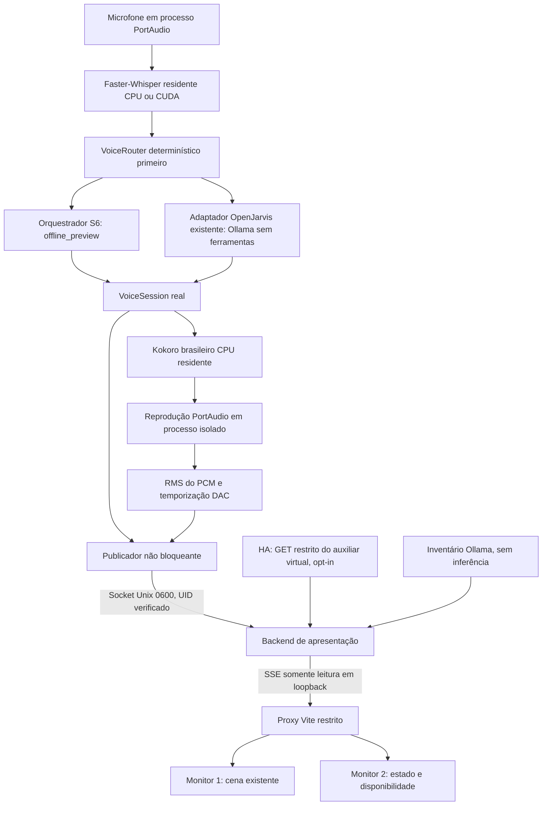
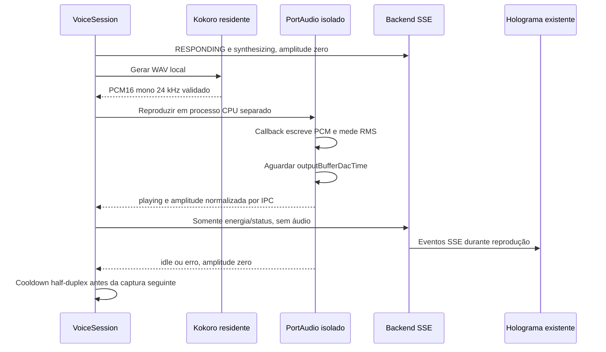

# Sprint 9 — voz real e apresentação local

Integração da sessão S7 com as telas S8, sem controle físico por voz ou navegador.
[Resultados e pendências](../reports/sprint-9-acceptance.md).
[Contrato v2](presentation-events.md).
[Controles supervisionados futuros](supervised-physical-automation.md).

## Arquitetura



Só há uma CLI de voz. Abrir duas janelas não cria modelos, captura, LLM ou TTS.
O backend de apresentação não inicia a sessão nem importa modelos pesados.
Ele observa serviços e distribui eventos; não oferece comandos, terminal ou
publicação HTTP. O navegador não acessa HA/Ollama diretamente.

## Iniciar os três componentes

Da raiz `openjarvis`, com o ambiente virtual existente:

```bash
export PYTHONPATH=projects/jarvis-room/src:src
```

Terminal 1, backend de apresentação (não grava nem gera respostas):

```bash
.venv/bin/python -m jarvis_room.presentation_server
```

Terminal 2, frontend:

```bash
cd projects/jarvis-room/frontend
npm run dev
```

Abra simultaneamente:

- `http://127.0.0.1:5174/monitor/1`
- `http://127.0.0.1:5174/monitor/2`

Em cada janela, abra **Controles** (ou D) e selecione **LIVE · backend local
somente leitura**. DEMO continua disponível e independente, sem áudio real.
LIVE começa com dados desconhecidos e só mostra conexão após handshake válido.

Terminal 3, **etapa humana supervisionada de voz**, da raiz do repositório:

```bash
PYTHONPATH=projects/jarvis-room/src:src .venv/bin/python -m jarvis_room.room_voice_cli \
  --stt-model-dir "$HOME/.local/share/jarvis-room/models/whisper-large-v3-turbo" \
  --stt-device cuda --stt-compute-type float16 \
  --llm --llm-model qwen3.5:4b --tts-backend none --presentation --metrics
```

Enter ativa a janela. Aguarde o aviso de microfone efetivamente aberto. Continue
os turnos sem repetir Jarvis; STT permanece residente. Ctrl+C/EOF encerra a CLI;
Ctrl+C no terminal 1 encerra o backend e remove apenas seu próprio socket.
SIGTERM também encerra o backend. Não iniciar várias CLIs de voz por monitor.

CPU continua disponível com `--stt-device cpu --stt-compute-type int8` e um
modelo local adequado. Não há download nem mudança automática de precisão.
A política de contexto/memória S7 permanece: quatro pares/1800 caracteres,
prompt 3800, saída 192 tokens e contexto 4096 por padrão. Modelo instalado
Qwen 3.5 4B; disponibilidade não certifica respostas nem coexistência na GPU.

## Portas, origem e IPC

| Recurso | Destino | Restrição |
| --- | --- | --- |
| Frontend | `127.0.0.1:5174` | Servidor de desenvolvimento local |
| SSE | `127.0.0.1:8765/events` | Apenas GET, sem CORS aberto ou rota de publicação |
| Proxy do navegador | `/api/presentation/events` | Só esse caminho exato vai ao SSE |
| Publicação Python | `/tmp/jarvis-presentation-UID/events.sock` | Diretório 0700, socket 0600, SO_PEERCRED do mesmo UID |
| Ollama existente | `127.0.0.1:11434` | Inventário GET e adaptador informativo existente |
| HA laboratório | `127.0.0.1:18123` | Somente GET autorizado do auxiliar virtual |

Host HTTP precisa ser `127.0.0.1:PORTA`. Origem, quando enviada, precisa ser
`http://127.0.0.1:5174`; `Sec-Fetch-Site=cross-site` é rejeitado. O navegador usa
o proxy de mesma origem, sem receber segredo. Não existe endpoint HTTP de
publicação, execução ou conversa de entrada. Métodos de escrita não são atendidos.

O UID autentica o processo Unix como pertencente ao usuário local, não como
identidade do operador. Código malicioso sob esse mesmo UID pode falsificar
apresentação, mas não recebe execução física. Loopback/origem não autenticam
clientes locais de leitura: habilite conteúdo pessoal apenas num ambiente local
confiável. Não compartilhar credenciais na conversa.

Um produtor por backend, até seis assinantes SSE, oito handlers HTTP e dois
handlers Unix. Mensagens Unix limitadas a 8192 bytes; filas publicador/assinante
de 64/128 eventos. Consumidor lento é desconectado, sem atrasar áudio.
Sessão/época UUID e sequência segura crescente; reconexão recebe snapshot atual,
descarta dados anteriores e ignora callbacks de transportes encerrados.
Heartbeat SSE a cada 2 s; frontend invalida após 8 s sem heartbeat. Lease do
produtor expira após 6 s sem mensagem, verificada a cada 250 ms. Um produtor
antigo não pode encerrar o lease do substituto.

Socket existente não é apagado automaticamente na inicialização. Se um processo
for morto abruptamente e deixar um socket, confirme primeiro que não há backend
ativo e inspecione proprietário/permissões antes de qualquer remoção manual.
`--socket /CAMINHO/PRIVADO/events.sock` e `--presentation-socket` precisam coincidir;
o diretório deve pertencer ao usuário e ter 0700. O proxy usa a porta padrão 8765.

## TTS e pulsação

Neste ambiente faltam **Kokoro, Torch e os assets locais**. `espeak-ng` está
disponível. Não foram instalados ou baixados modelos nesta sprint. Siga a
preparação explícita do [guia S7](voice-interaction.md) quando autorizada e
registre revisão/licença dos arquivos. Voz candidata inicial `pm_santa`, pipeline
brasileiro `p`; naturalidade e pronúncia ainda exigem audição.

Depois de preparar dependências e arquivos, a sessão supervisionada com TTS é:

```bash
PYTHONPATH=projects/jarvis-room/src:src .venv/bin/python -m jarvis_room.room_voice_cli \
  --stt-model-dir "$HOME/.local/share/jarvis-room/models/whisper-large-v3-turbo" \
  --stt-device cuda --stt-compute-type float16 \
  --llm --llm-model qwen3.5:4b --presentation \
  --tts-backend kokoro --tts-model-dir "$HOME/.local/share/jarvis-room/models/kokoro" \
  --voice pm_santa --speed 1.0 --volume 0.7 --metrics
```

`tts_prerequisites` verifica pacotes, espeak e arquivos sem carregar modelo.
Ausência de dependência preserva texto e disponibilidade negativa no dashboard.
Configuração, pesos e tensor de voz devem estar completos/localmente presentes.
Velocidade 0,5–2, volume 0–1; dispositivo via `--output-device N` após diagnóstico.
Somente abrir a saída confirma que é utilizável; arquivo existente não comprova
síntese válida. Falhas de modelo/dispositivo têm fallback sem indicar fala ativa.



Callback de saída a 24 kHz, blocos de 960 amostras (40 ms). Volume é aplicado
antes do RMS; RMS/32768 normaliza em 0–1. Filtro de ataque 0,65/liberação 0,25
suaviza os valores. O callback escreve numa fila limitada, nunca em rede/pipe.
O loop principal agenda cada valor pelo tempo DAC informado pelo PortAudio.
Não publica a animação toda durante síntese. Finalização espera drenagem da
saída; cancelamento/erro força zero, inclusive no supervisor que mata o worker.

O worker de reprodução reaproveita o protocolo enquadrado da S7, com respostas
intermediárias tipadas e mesmo ID, seguido do resultado final. É CPU, separado
de STT/Kokoro e supervisionado por timeout/cancelamento/parent-death guard.
O quadro privado também leva tempo monotônico: progresso playing/energia
positiva com atraso superior a 500 ms no pipe é descartado pelo supervisor;
fim/zero continuam sendo entregues. Esse campo não é publicado ao navegador.
Half-duplex permanece: captura e detector fechados durante síntese/reprodução,
cooldown padrão 0,8 s, nova fila na próxima captura. Não há interrupção por voz.

Em LIVE, `RESPONDING` significa preparar/responder; só `playback_status=playing`
permite energia positiva e indicação de fala real. `synthesizing`, indisponível
ou erro não simulam pulsação. Frontend zera energia sem progresso por 500 ms
(watchdog de 250 ms); backend usa limiar de 750 ms (verificação de 250 ms).
Eventos de energia com timestamp mais de 1,5 s fora do relógio local são rejeitados.
Os relógios WSL/Windows precisam estar coerentes. O áudio passa ainda por buffers
do Windows/WSLg: sincronização perceptiva/jitter exigem homologação, sem promessa
de precisão acústica absoluta.

A cena mantém núcleo, anéis, partículas, fundo e suavização existentes. O núcleo,
escala e brilho recebem a energia real pela mesma prop usada pela S8. Movimento
reduzido e qualidade visual continuam respeitados. O modo SVG de compatibilidade
não certifica a animação WebGL da sala.

## Conversa opcional no Monitor 2

Nada é compartilhado por padrão. Acrescente **`--share-conversation`** à CLI com
`--presentation` e, no Monitor 2, marque **Mostrar conteúdo compartilhado pelo
operador**. Apenas pares informativos são publicados: pergunta até 256,
resposta até 700 caracteres. Planos físicos não são enviados como conversa.
Renderização usa texto React, sem HTML executável. Conteúdo nunca retorna ao
interpretador. O snapshot guarda somente o último par em memória e é apagado
na desconexão/troca de sessão. Não há histórico persistente ou entrada de texto
pelo navegador; continue usando a CLI para conversar.

## Home Assistant: opt-in somente leitura

Por padrão não há GET HA. Para uma homologação autorizada, forneça um arquivo
privado já preparado, fora do repositório, proprietário correto e 0400/0600:

```bash
JARVIS_HA_LAB_READ=1 PYTHONPATH=projects/jarvis-room/src:src \
  .venv/bin/python -m jarvis_room.presentation_server \
  --read-lab --ha-token-file "$HOME/.config/jarvis-room/ha-lab.token"
```

Reutiliza `HALabReadOnlyClient` e validação do arquivo S3. Entidade exata
`input_boolean.jarvis_lab_light`, timeout GET 2 s, leitura a cada ciclo de 5 s.
Não há redirects/proxies, POST ou chamadas de serviço. Token fica no processo
Python e nunca é publicado. O token HA pode possuir permissões amplas; o cliente
é que restringe a operação a GET.

Esse auxiliar é **virtual**, separado da iluminação física. Não promove
`room_main_lights` a conectado, não comprova estado elétrico e não reutiliza as
entidades Samsung antigas. Catálogo e cenas continuam os JSON canônicos; todos
os planejados permanecem planejados e a Samsung fica sem observação atual.
Não se publicam temperatura, presença ou consumo inventados.

## Diagnóstico e homologação

```bash
PYTHONPATH=projects/jarvis-room/src:src .venv/bin/python -m jarvis_room.room_voice_cli --diagnose
PYTHONPATH=projects/jarvis-room/src:src .venv/bin/python -m jarvis_room.room_voice_cli --diagnose-ollama
```

Diagnóstico não grava, sintetiza ou gera respostas. No backend, sem sessão de
voz, `voice/stt/tts=unavailable` é esperado. Ollama/modelo conectado significa
inventário acessível/pacote instalado, não resposta homologada. Cada serviço
traz horário de observação, UTC no evento e fuso do navegador na tela. STT
conectado registra a carga observada; não é inspeção contínua da GPU ociosa.

| Sintoma | Verificação |
| --- | --- |
| LIVE reconectando | Backend em 8765, Vite em 5174, proxy exato e Host/origem |
| Voz desconhecida/indisponível | Uma CLI com `--presentation`, mesmo socket, permissões, erro da sessão |
| Sem energia, RESPONDING | TTS ausente, ainda sintetizando ou falha de saída; não há fala simulada |
| Energia interrompida | Logs sanitizados da CLI, overflow/timeout, atraso SSE e relógios WSL/Windows |
| Ollama indisponível | `--diagnose-ollama`; confirmar serviço e nome instalado, sem pull automático |
| HA sem leitura | Opt-in, arquivo privado, auxiliar existente e autorização de homologação |
| HTTP 504 ao abrir a cena | Pré-bundle configurado dos imports 3D e cache específico do projeto; não apagar arquivos/modelos |

Roteiro humano: diagnosticar; iniciar backend/frontend e selecionar LIVE;
testar voz sem TTS; comparar estados/cancelamento; habilitar Kokoro preparado;
observar início/progresso/fim, silêncio, volume e falha de saída; medir atraso
percebido em fones/alto-falantes, reverberação/eco e conversa de vários turnos;
só depois realizar GET HA com autorização. Nenhum passo concede controle físico.

## Testes reproduzíveis

```bash
python3.11 projects/jarvis-room/scripts/run_offline_tests.py
git diff --check
cd projects/jarvis-room/frontend
npm test
npm run build
npm run test:e2e
```

E2E requer Chromium e bibliotecas de navegador. Nesta entrega foram preparados
somente em `/tmp`; não se instalaram pacotes do sistema. Reprodução dessa opção:

```bash
PLAYWRIGHT_BROWSERS_PATH=/tmp/jarvis-s9-playwright \
  ./node_modules/.bin/playwright install chromium --only-shell
# Se libnspr4/libnss3 faltarem, preparar bibliotecas de teste explicitamente.
LD_LIBRARY_PATH=/tmp/jarvis-s9-browser-libs/extracted/usr/lib/x86_64-linux-gnu \
  PLAYWRIGHT_BROWSERS_PATH=/tmp/jarvis-s9-playwright npm run test:e2e
```

O último comando usa as bibliotecas temporárias já preparadas nesta sessão;
não é requisito da aplicação. Em outro ambiente, seguir a preparação do
Playwright. Os testes usam SSE/áudio/LLM/HA falsos, sem GPU e sem rede externa.
O servidor Vite local serve apenas a UI. Testes não homologam dispositivos,
qualidade de voz, GPU ou latência perceptiva.

Preparação temporária das duas bibliotecas faltantes usada nesta máquina, sem
sudo e sem instalar pacotes no sistema (download explícito de ferramentas de teste):

```bash
mkdir -p /tmp/jarvis-s9-browser-libs
cd /tmp/jarvis-s9-browser-libs
apt-get download libnspr4 libnss3
python3.11 - <<'PY'
from pathlib import Path
import subprocess
root = Path('/tmp/jarvis-s9-browser-libs')
for package in root.glob('*.deb'):
    subprocess.run(['dpkg-deb', '-x', str(package), str(root / 'extracted')], check=True)
PY
```

Depois volte à pasta `projects/jarvis-room/frontend` do repositório para executar
o E2E com os dois prefixos temporários indicados acima. Essa preparação não
altera STT/CUDA, modelos, configuração de áudio ou serviços existentes.

Referências: [SSE](https://developer.mozilla.org/en-US/docs/Web/API/Server-sent_events/Using_server-sent_events),
[RawOutputStream](https://python-sounddevice.readthedocs.io/en/latest/api/raw-streams.html) e
[pré-bundle Vite](https://vite.dev/config/dep-optimization-options.html).
