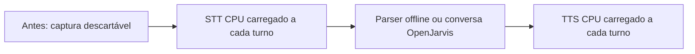
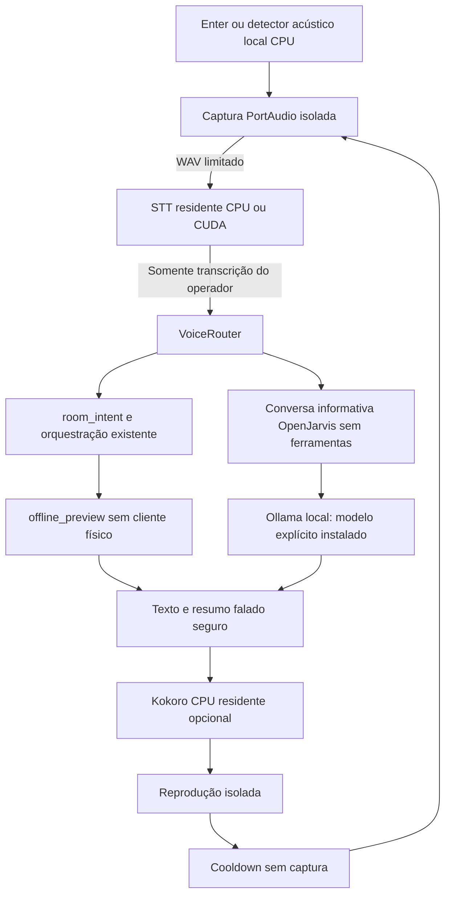

# Sprint 7 — consolidação técnica da comunicação por voz

Data: 19/10/2026, America/Bahia. Repositório `JotakuGr/jarvis-room-private`.
Branch `feature/sprint7-voice-interaction`.
Estado: implementação pronta para revisão técnica; **não é homologação final**.
Controle físico por voz permanece desabilitado. Nenhum PR ou merge criado.

Atualização posterior: o modelo preferido da sessão de voz passou a
`qwen3.5:4b`, a pedido do operador. Os resultados e o inventário da consolidação
abaixo são históricos; comandos atuais no
[guia GPU/LLM](../integrations/voice-gpu-ollama.md).

## Resumo executivo

STT aceita configuração CPU/CUDA explícita e mantém o modelo em um worker
residente, separado de PortAudio. A sessão reutiliza o reconhecimento entre
turnos e ativações, mantém contexto informativo curto e oferece diagnóstico,
timeout, cancelamento e recuperação sem repetir áudio automaticamente.
Ollama pode ser selecionado pelo nome exato instalado; perguntas naturais e
acompanhamentos usam o adaptador OpenJarvis existente, sem ferramentas.
TTS brasileiro CPU residente está integrado como opção, com fallback textual.
S7.1 e suas variantes `liga/ligue`, `desliga/desligue` foram preservadas.

A baseline local foi confirmada em **734 testes** antes da implementação.
Resultado final: **830/830**, com **96 novos**; mais **11 testes upstream de
fala**, executados separadamente. Ruff, whitespace e CI remoto aprovados.
Foi realizada carga/liberação real do Whisper Turbo em CUDA/FP16, sem
transcrever. Não houve nova captura de microfone, inferência STT, geração LLM,
síntese TTS, reprodução ou acionamento físico nesta consolidação.

| Subsistema | Implementado/testado offline | Evidência real desta entrega | Pendência |
| --- | --- | --- | --- |
| Captura e saída | Separação, prontidão, limites, cancelamento e fakes | PortAudio e `pulse` enumerados | Abrir microfone e avaliar reprodução |
| STT | CPU/CUDA, precisão, uma carga/vários turnos, falhas | Turbo carregado/liberado na RTX 4070 | Transcrições consecutivas e qualidade brasileira |
| Parser | S7.1, aliases, grupos/cenas e bloqueios preservados | Sem operação física | Avaliar erros acústicos de verbo/negação |
| Ollama | Seleção, contexto, falhas, timeout, roteamento sem ferramentas | Serviço/inventário local consultados | Gerar e avaliar respostas reais |
| Sessão | Estados, prontidão, inatividade, vários turnos e métricas | Carga isolada e limpeza de processo | Conversa contínua com hardware |
| TTS | Kokoro brasileiro residente CPU e reprodução isolada | `espeak-ng` disponível | Kokoro/Torch e pesos/vozes ausentes; audição pendente |
| Wake word | Infraestrutura acústica, rate limit e Enter | Pacote/ONNX ausentes | Modelo/licença local e avaliação; Jarvis isolado pendente |

## Estado inicial e preservação

HEAD inicial `e2ce261d5525c9452b35c5046f2842fc0b120650`, na branch solicitada.
A árvore continha quatro arquivos modificados e um novo teste da S7.1:
`room_intent.py`, README, guia de voz, relatório de aceite e
`test_room_natural_variants.py`. Foram inspecionados e preservados, sem reset,
checkout forçado ou descarte. Regressão inicial: 734 testes em 2,217 s.
Essas alterações foram registradas separadamente no commit `9f841c98`.

Auditamos CLI, worker, backends, áudio, contratos, sessão, roteador, diagnóstico,
benchmark, parser/normalização, orquestrador/respostas e adaptadores/política de
inferência. O ponto de controle físico continua sendo o contrato existente:
voz não produz uma entrada autorizada do terminal Samsung.

## Arquitetura antes e depois





Fluxo conversacional detalhado e decisões:
[ADR-0006](../adr/0006-resident-voice-workers.md).
O [ADR-0005](../adr/0005-local-voice-session.md) e o
[relatório original](sprint-7-acceptance.md) preservam os resultados históricos.

### Workers e ciclo de vida

- STT/TTS residentes: pipes stdin/stdout privados, JSON com comprimento e ID,
  até 2 MiB por quadro; uma operação simultânea, sem porta pública ou pickle.
- STT aceita apenas inicialização e transcrição; TTS apenas inicialização e
  síntese. WAV STT PCM16 mono 16 kHz até 30 s; TTS PCM16 mono 24 kHz até 30 s.
- Inicialização STT precede a janela ativa; chamada `prepare` posterior
  reaproveita a mesma instância. Carga preguiçosa de TTS reaproveita o backend.
- Captura, wake e reprodução são processos separados, com GPU oculta.
  Helpers PCM stdlib foram extraídos sem remover a interface `voice_io`.
- Timeout/cancelamento mata grupo, aguarda processo, fecha pipes e temporários.
  Proteção Linux `PR_SET_PDEATHSIG` encerra filhos se o pai desaparecer.
  Falha não repete áudio, não utiliza resultado tardio e exige nova ativação.
- Não há arquivo persistente de áudio. O STT residente usa `BytesIO`;
  temporários privados do supervisor descartável são fechados automaticamente.
  O benchmark exporta transcrições somente quando solicitado explicitamente.

### Sessão e experiência

Estados `IDLE`, `LISTENING`, `TRANSCRIBING`, `THINKING`, `RESPONDING`, `ERROR`.
O aviso de escuta só ocorre depois de abrir o stream. Carga de STT é anunciada
separadamente. Defaults da CLI: janela 300 s, inatividade 30 s, até 20 tentativas
de captura, captura até 15 s, operação até 60 s e startup até 120 s. Defaults
legados do dataclass permanecem compatíveis com seus consumidores anteriores.

Enter inicia uma janela; os turnos seguintes não exigem Jarvis. Silêncio pode
iniciar outra captura dentro dos limites. Nova ativação reutiliza STT enquanto
a sessão vive. Falha de microfone/STT fecha a janela e mantém a interface
disponível para Enter. LLM/TTS indisponíveis fornecem fallback textual.
EOF/Ctrl+C encerram os processos e limpam contexto. Não há full-duplex.

## Implementação e arquivos

Os caminhos desta tabela são relativos a `projects/jarvis-room/`, exceto onde
indicados como raiz do repositório. O commit de código contém 27 arquivos.

| Arquivos | Mudança e motivo |
| --- | --- |
| `src/jarvis_room/voice_stt.py` (novo) | Configuração validada, bibliotecas CUDA, verificação CT2, modelo único e métricas |
| `src/jarvis_room/voice_resident.py` (novo) | IPC limitado, supervisão, cancelamento, limpeza e transcritor residente |
| `src/jarvis_room/voice_llm.py` (novo) | Inventário GET fixo local e seleção explícita/limites de modelo |
| `src/jarvis_room/voice_persona.py` (novo) | Persona, filtro informativo e texto falado curto centralizados |
| `src/jarvis_room/voice_tts.py` (novo) | Kokoro brasileiro residente CPU e validação/reprodução separada |
| `src/jarvis_room/room_voice_cli.py` | Flags GPU/LLM/TTS, diagnósticos, carga isolada, conversa textual e fallback |
| `voice_worker.py`, `voice_backends.py` no mesmo diretório | Política CUDA por operação, servidor privado residente, proteção de pai, cliente LLM serializado |
| `voice_contract.py`, `voice_session.py`, `voice_router.py` | Contratos, inatividade/contexto, prontidão real, métricas, erros e roteamento |
| `voice_audio.py`, `voice_diagnostics.py`, `voice_benchmark.py` | Áudio sem import CUDA, inventário passivo e benchmark residente |
| `conversation_adapter.py`, `openjarvis_provider.py`, `provider_chat_adapter.py` | Seleção explícita do modelo e tokens, reutilizando agente/adaptadores |
| `src/openjarvis/_audio_pcm.py` (novo, raiz) | Helpers stdlib compartilhados com compatibilidade de import |
| `src/openjarvis/speech/voice_io.py` (raiz) | Reexportação dos helpers anteriores |
| `src/openjarvis/speech/faster_whisper.py` (raiz) | Opções locais/BytesIO e parâmetros de transcrição, defaults antigos preservados |
| Quatro testes novos e dois testes existentes de voz | Contratos GPU/residência/LLM/TTS/CLI e fallback |
| `.github/workflows/jarvis-room-unittest.yml` (raiz) | Trigger helper PCM; Ruff versionado além da regressão/whitespace |

Documentação: este relatório, novo guia
[`voice-gpu-ollama.md`](../integrations/voice-gpu-ollama.md), ADR-0006,
README, guia de instalação, referência no ADR-0005 e relatório de aceite.
Não foi necessário reescrever o parser/orquestrador ou alterar os contratos
Samsung, clientes HA, permissões ou política global de memória existente.

## Ambiente e GPU

Inspeção real: Ubuntu 24.04/WSL2, kernel
`6.18.54.1-microsoft-standard-WSL2`, Python **3.11.17**, RTX 4070 índice 0,
VRAM total **12282 MiB**. CPU Ryzen 7 7800X3D informada pelo operador.
RAM observada: total 15914680 KiB, disponível 13239768 KiB; swap total/livre
4194304 KiB. Espaço livre observado aproximadamente 939 GiB. São snapshots,
não reservas ou garantias de capacidade.

| Dependência inspecionada em `.venv` | Versão |
| --- | --- |
| Faster-Whisper | 1.2.1 |
| CTranslate2 | 4.8.3 |
| NVIDIA cuBLAS CUDA 12 | 12.9.2.10 |
| NVIDIA cuDNN CUDA 12 | 9.27.0.42 |
| sounddevice / soundfile | 0.5.6 / 0.14.0 |
| NumPy / ONNX Runtime | 2.2.6 / 1.31.0 |
| httpx / Ruff | 0.28.1 / 0.16.9 |
| Kokoro / Torch / openWakeWord | Ausentes |

cuBLAS/cuDNN encontrados em
`.venv/lib/python3.11/site-packages/nvidia/cublas/lib` e `nvidia/cudnn/lib`.
Descoberta pelos metadados pip e ambiente do filho antes da inicialização;
nenhuma alteração permanente ou export manual exigido.

STT padrão CPU/int8; CUDA/float16 exige opt-in. Índice GPU 0–31 e beam 1–5.
Outros tipos só prosseguem se `get_supported_compute_types` confirmar. O
dispositivo e a precisão reais do modelo são reportados. Não há fallback
silencioso de CUDA para CPU. Falha CUDA/OOM resulta em erro de subsistema e
limpeza; não em uma segunda carga paralela.

Modelo já presente fora do Git:
`~/.local/share/jarvis-room/models/whisper-large-v3-turbo`.
Origem informada: `deepdml/faster-whisper-large-v3-turbo-ct2`.
Metadados locais Hugging Face: revisão
`4df90f75321148c3a29a9e2351b7ddf8f5b115a8`, model.bin 1.617.884.929 bytes,
etag/digest local
`e76620f83d5f5b69efd3d87e3dc180c1bd21df9fbebacfd4335e5e1efcc018da`.
Esse digest foi lido dos metadados, não recalculado nesta entrega. Model card
local declara MIT. `whisper-tiny` também existe; `base` não foi encontrado.
Nenhum peso foi baixado, substituído ou versionado.

Idioma `pt`, beam configurável, `condition_on_previous_text=False`, VAD e
terminologia da sala opcionais. Contexto linguístico não autoriza ações e
não corrige automaticamente palavras sensíveis. S7.1 mantém os alvos completos,
negações/condições/compostos bloqueados e os aliases efetivamente cadastrados.

## LLM local

Consultamos o serviço existente em **`http://127.0.0.1:11434`**, Ollama **0.40.6**.
Inventário: somente **`qwen3.5:0.8b`**, tamanho 1.322.069.277 bytes,
GGUF Q8_0, aproximadamente 752,39 milhões de parâmetros. Digest:
`de63045f29755d4721c09d54c9b45c2dadb644f4fd7d604d4cac90d96049971c`.
Nenhum modelo carregado em `/api/ps` no momento da inspeção.
`jarvis-dev-lite:latest` ausente. Não fizemos `pull` nem geração de resposta.

`--llm --llm-model qwen3.5:0.8b` seleciona explicitamente o modelo instalado.
Nome inexistente, servidor indisponível e modelo acima do orçamento são
recusados. O orçamento padrão é 4 GiB de pesos, não um teto de VRAM.
Uma requisição por vez evita cargas concorrentes da própria interface;
o servidor externo continua responsável por seus recursos. A política anterior
de RAM/swap continua aplicada. Coexistência de STT e geração LLM na GPU ainda
não foi medida; snapshots de STT isolado não comprovam essa capacidade.

Perguntas como `como você está?`, `qual é a função do Home Assistant?`,
`me explique...`, `pode explicar isso de outra forma?` e `e como isso funciona?`
são aceitas por uma classificação conservadora. Não há interpretação física
por LLM, fuzzy matching ou autorização baseada em palavras-chave.
O parser conhecido roda primeiro; instruções desconhecidas ficam bloqueadas.

Persona profissional em português, quatro pares/1800 caracteres de histórico,
prompt até 3800, resposta armazenada até 700, saída padrão 192 tokens e
contexto 4096 tokens. Contexto é volátil e limitado, retido entre ativações
próximas; contexto vencido é descartado ao reativar, e fechamento/cancelamento
limpam imediatamente. Não registramos diálogos ou credenciais em arquivos.

Erros/timeout/resposta vazia têm fallback. Timeout mata o cliente, não o serviço
Ollama: uma geração externa pode continuar. Para impedir sobreposição de pedidos
depois desse timeout, exige-se reiniciar a sessão antes da próxima inferência.
Afirmações conhecidas de sucesso físico são substituídas na saída/histórico;
esse filtro suplementar não certifica a exatidão de outras respostas do modelo.

## TTS e wake word

Kokoro CPU reutiliza a interface OpenJarvis, configura pipeline brasileiro
`p`, voz/tensores/config/pesos locais e modelo residente. Candidatas
`pm_santa` e `pm_alex` masculinas, `pf_dora` feminina; preferência inicial
`pm_santa`, sem afirmação de qualidade auditiva. PCM/WAV validado antes de
reproduzir; velocidade, volume e dispositivo selecionáveis, sem API externa.

Bloqueio concreto: **Kokoro/Torch e pesos/vozes locais ausentes**. `espeak-ng`
está disponível. A infraestrutura passou com fakes, mas não houve síntese,
reprodução ou audição reais. Kokoro-82M declara Apache 2.0 e lista essas vozes
como brasileiras. Piper foi considerado como alternativa futura; sua
implementação atual GPL-3.0 e cada voz exigiriam preparação/licenças próprias.
Não adicionamos um segundo backend sem modelo para validar.

openWakeWord continua acústico e CPU, com limiar, energia, frames consecutivos,
janela limitada e até seis detecções/minuto. Fallback Enter foi testado.
Pacote/ONNX não estão instalados. A CLI requer os três ONNX e registro local
de origem/licenças. O arquivo de registro não autentica criptograficamente
os pesos nem substitui avaliação humana. O projeto upstream declara código
Apache 2.0/modelos pré-treinados CC BY-NC-SA 4.0.
O modelo público é “hey Jarvis”; “Jarvis” isolado permanece sem modelo e
avaliação específicos. Nenhuma taxa de falsos positivos foi medida aqui.

Half-duplex: detector/microfone e suas filas terminam antes da resposta.
Reprodução isolada, cooldown padrão 0,8 s e novo stream na captura seguinte.
Rejeição textual de eco recente é defesa suplementar, não autenticação.
Voz/áudio de terceiros pode gerar ativação ou preview, nunca execução física.

## Diagnóstico e desempenho

PortAudio enumerado: V19.6.0-devel, APIs ALSA/OSS, dispositivo 0 `pulse`,
32 canais de entrada/saída, default 44100 Hz e dispositivos padrão `[0, 0]`.
WSLg/socket acessíveis, `/dev/snd` presente com leitura e sem escrita; isso
não impede usar Pulse/WSLg. `pactl` e `espeak-ng` disponíveis. A enumeração
restrita inicial expirou e seu filho foi encerrado; repetição com acesso ao
ambiente real enumerou os dispositivos. Nenhum stream foi aberto.

Foram feitos dois testes novos de **carga/liberação**, zero transcrições:

| Métrica | Primeira carga observada | Carga com métricas completas |
| --- | --- | --- |
| Carga/construção do backend STT | 2,2784 s | 1,5838 s |
| Inicialização completa do worker | Não registrada | 2,1332 s |
| Pico RSS do worker | 1820240 KiB | 1820556 KiB |
| Dispositivo/tipo reais | CUDA/float16 | CUDA/float16 |
| Transcrições | 0 | 0 |

Na segunda carga, memória usada **global da GPU**: 2107 MiB antes, 4244 MiB
carregado, 2139 MiB após liberação; total 12282 MiB. Esses valores incluem
outros processos e flutuações, não representam atribuição precisa ao STT.
Consulta posterior não encontrou workers de voz remanescentes.

O operador havia informado carga 1,79 s e uma transcrição de 0,38 s para
`Jarvis, liga os monitores`. É uma medição histórica fornecida pelo operador,
não repetida aqui. **0,38 s não é latência total da conversa**.
Não temos nova primeira transcrição, transcrições subsequentes, WER, latência
de LLM/TTS/turno ou coexistência de inferências para publicar.

`--metrics` registra no terminal somente saúde, componentes, tempos e códigos
sanitizados. Não registra áudio/transcrição/prompt. Tempos disponíveis incluem
inicialização, captura, STT, roteador/LLM, TTS/cooldown e turno completo. Não
cria log persistente. Diagnósticos não capturam nem geram automaticamente;
`--stt-check` é uma operação separada e explicitamente ativa de carga.

## Testes e validação

| Conjunto | Quantidade | Resultado |
| --- | --- | --- |
| Baseline local S7.1 | 734 | Todos aprovados antes de alterar |
| `test_voice_stt_configuration.py` novo | 21 | Configuração CPU/CUDA/CT2, uma carga, pt/opções/BytesIO e falhas |
| `test_voice_resident.py` novo | 28 | Framing, limites, pai/filho, timeout/cancelamento/limpeza e múltiplos turnos |
| `test_voice_consolidation.py` novo | 37 | LLM, seleção, memória, segurança, sessão, métricas e TTS falso |
| `test_voice_cli_configuration.py` novo | 8 | CLI, diagnóstico, carga explícita, seleção e fallbacks |
| Novos casos no benchmark existente | 2 | Reuso residente e fechamento em falha |
| Total da Sala Temática | **830 = 734 + 96** | Aprovados localmente e no CI |
| Upstream `test_faster_whisper.py` e `test_voice_io.py` | **11 separados** | Aprovados com import/processo/rede substituídos |

Regressão final local: 830 testes em 2,593 s. Os 20 testes S7.1 permanecem.
Um teste anterior de resposta vazia/inválida do modelo foi atualizado para
exigir fallback textual seguro, em vez de exceção; mantidas flags físicas
falsas. Não foi removido teste nem relaxada autorização física.

Casos novos incluem GPU ausente/incompatível/OOM simulada, configuração por
operação, uma carga/muitas falas, cancelamento/timeout sem replay, falha de
espera ainda limpando recursos, CT2 fora da captura, idioma pt, contexto curto,
follow-up, modelo ausente, resposta vazia/extensa, prompt injection, comando na
resposta, alegação de execução física suprimida, wake limitada/licença/fallback,
half-duplex, startup fora da janela e prontidão real do microfone.

Runner bloqueia sockets, subprocessos reais, GPU, microfone, importação de
modelos pesados e qualquer HA. WAVs sintéticos, pipes locais, relógio virtual e
fakes/mocks verificam contratos. **Isso não mede qualidade acústica nem LLM**.
Os 11 upstream rodaram também com plugins pytest desabilitados, CUDA oculta,
HF offline, módulos Faster-Whisper/CT2 substituídos e bloqueios explícitos de
socket e `Popen`. Não alegamos executar toda a suíte upstream OpenJarvis.

Comandos aplicados:

```bash
python3.11 projects/jarvis-room/scripts/run_offline_tests.py
git diff --check
.venv/bin/ruff check projects/jarvis-room/src/jarvis_room/voice_*.py \
  projects/jarvis-room/src/jarvis_room/room_voice_cli.py \
  projects/jarvis-room/src/jarvis_room/room_intent.py \
  projects/jarvis-room/src/jarvis_room/conversation_adapter.py \
  projects/jarvis-room/src/jarvis_room/openjarvis_provider.py \
  projects/jarvis-room/src/jarvis_room/provider_chat_adapter.py \
  projects/jarvis-room/tests/test_voice_*.py \
  projects/jarvis-room/tests/test_room_natural_variants.py \
  src/openjarvis/_audio_pcm.py src/openjarvis/speech/faster_whisper.py \
  src/openjarvis/speech/voice_io.py
```

Ruff **All checks passed**, `git diff --check` sem erros. CI usa Python 3.11,
stdlib para a regressão, bloqueios offline e Ruff 0.16.9. Nenhum extra de voz,
peso, GPU ou serviço é necessário ao CI. O workflow agora observa também o
helper PCM e executa a mesma análise estática, além de whitespace.

Reprodução opcional dos 11 testes upstream locais (requer pytest já instalado,
sem instalar extras/modelos):

```bash
PYTHONPATH=src .venv/bin/python - <<'PY'
import os
import sys
from unittest.mock import patch

os.environ.update(CUDA_VISIBLE_DEVICES='', HF_HUB_OFFLINE='1',
                  TRANSFORMERS_OFFLINE='1', PYTEST_DISABLE_PLUGIN_AUTOLOAD='1')
sys.modules['faster_whisper'] = None
sys.modules['ctranslate2'] = None
import pytest

with patch('socket.socket.connect', side_effect=AssertionError('Offline')), \
     patch('subprocess.Popen', side_effect=AssertionError('Sem processo real')):
    raise SystemExit(pytest.main(['-q', 'tests/speech/test_faster_whisper.py',
                                 'tests/speech/test_voice_io.py']))
PY
```

## Segurança e fronteiras preservadas

1. Toda transcrição operacional vai ao parser/planejador S6/S7.1 em
   `offline_preview`, inclusive Samsung, grupos e cenas.
2. Não se importa/cria `OperatorTurn` autorizado, cliente HA, execução de script,
   token, novo privilégio Samsung ou autorização herdada de outro terminal.
3. LLM usa o adaptador existente: agente `simple`, `tools=[]`, `context=False`,
   configuração temporária, sem MCP/telemetria/traces, endpoint local fixo.
4. Saídas de modelo/histórico são dados não confiáveis. Não voltam ao parser,
   não executam comandos e não comprovam estado físico. Flags verificadas são
   sempre falsas; planos declaram que nenhum comando físico foi enviado.
5. Não há servidor público, download normal/automático de modelos, gravação
   persistente de áudio/diálogos ou credencial adicionada ao repositório.
6. Wake word, contexto STT e voz não autenticam o operador. Half-duplex e filtro
   de eco reduzem realimentação; não prometem resistência a replay/terceiros.

## Comandos reproduzíveis e homologação posterior

Da raiz do repositório:

```bash
export PYTHONPATH=projects/jarvis-room/src:src

# Passivos: sem gravação, carga de pesos ou inferência.
.venv/bin/python -m jarvis_room.room_voice_cli --diagnose
.venv/bin/python -m jarvis_room.room_voice_cli --diagnose-gpu
.venv/bin/python -m jarvis_room.room_voice_cli --diagnose-ollama --llm-model qwen3.5:0.8b
.venv/bin/python -m jarvis_room.room_voice_cli --diagnose-stt \
  --stt-model-dir "$HOME/.local/share/jarvis-room/models/whisper-large-v3-turbo" \
  --stt-device cuda --stt-compute-type float16

# Ativo, sem transcrever: carga/liberação STT GPU.
.venv/bin/python -m jarvis_room.room_voice_cli --stt-check --metrics \
  --stt-model-dir "$HOME/.local/share/jarvis-room/models/whisper-large-v3-turbo" \
  --stt-device cuda --stt-compute-type float16

# Teste humano LLM, só texto, sem microfone/TTS.
.venv/bin/python -m jarvis_room.room_voice_cli --text-chat \
  --llm --llm-model qwen3.5:0.8b

# Teste humano STT e conversa, TTS desabilitado inicialmente.
.venv/bin/python -m jarvis_room.room_voice_cli \
  --stt-model-dir "$HOME/.local/share/jarvis-room/models/whisper-large-v3-turbo" \
  --stt-device cuda --stt-compute-type float16 \
  --llm --llm-model qwen3.5:0.8b --tts-backend none --metrics

# Somente depois de instalar/preparar explicitamente Kokoro e vozes locais.
.venv/bin/python -m jarvis_room.room_voice_cli \
  --stt-model-dir "$HOME/.local/share/jarvis-room/models/whisper-large-v3-turbo" \
  --stt-device cuda --stt-compute-type float16 \
  --llm --llm-model qwen3.5:0.8b --tts-backend kokoro \
  --tts-model-dir "$HOME/.local/share/jarvis-room/models/kokoro" \
  --voice pm_santa --speed 1.0 --volume 0.7 --metrics
```

Omitir `--llm` isola o teste STT/parser. Sem NVIDIA, selecionar CPU/int8 e modelo
adequado. Os comandos interativos exigem TTY, serviço/modelos locais e operador
presente; foram verificados por contratos/help, não por conversa real nesta
entrega. Diagnósticos e `--stt-check` foram executados conforme evidências acima.

O [guia operacional](../integrations/voice-gpu-ollama.md) fornece opções de
dispositivos, benchmark, instalação, wake e roteiros. Ordem humana proposta:

1. Diagnóstico e LLM textual: identidade, funções, explicação e follow-up,
   indisponibilidade, contexto apagado e respostas factuais avaliadas pelo operador.
2. STT sem TTS: comandos válidos, negação, alvo desconhecido/composto, silêncio,
   repetição de turnos, Ctrl+C e comparação de vocabulário/VAD/beam com corpus.
3. STT+LLM: carga inicial, primeira transcrição, seguintes, tempos do turno,
   RAM/VRAM, possíveis falhas/OOM, sem executar dispositivos.
4. Só depois, TTS: comparar três vozes, inteligibilidade/naturalidade, pronúncia
   de J.A.R.V.I.S., LEDs, Samsung, Hikvision e WLED; ritmo, volume, eco, latência
   e diálogo prolongado. Avaliação auditiva não pode ser inferida de WAV válido.
5. Wake separada: modelo/licença preparados, fala brasileira, “hey Jarvis” versus
   “Jarvis”, ruído, TV/terceiros, acertos e falsas ativações/hora; preservar Enter.

## Pendências por categoria

- **Implementado/testado offline:** configuração CPU/CUDA, residência STT/TTS,
  protocolo/ciclo de vida, parser S7.1, conversa/contexto/fallback, half-duplex,
  diagnóstico e ausência de execução física; regressão/CI aprovados.
- **Validado em hardware/serviço real:** GPU/precisão compatíveis, cuBLAS/cuDNN,
  carga/liberação Turbo, pico RSS/snapshots GPU; inventário/versão Ollama e
  enumeração PortAudio/WSLg. Nenhuma dessas evidências homologa a conversa.
- **Não validado:** captura/transcrição atual, qualidade/acurácia, inferências
  seguintes/latência total, coexistência STT/LLM, respostas reais e eco na sala.
- **Bloqueado por dependência local ausente:** Kokoro/Torch/pesos/vozes e
  openWakeWord/ONNX/registro de licenças. Não instalamos/baixamos automaticamente.
- **Próxima avaliação humana:** escolha auditiva TTS, pronúncia/persona, corpus
  brasileiro e modelo para “Jarvis” isolado. Piper e full-duplex não implementados;
  qualquer controle físico futuro exige outro escopo e homologação específicos.

## Git e CI

Commits desta solicitação:

- `9f841c984ff9ebc000bde3177fd9ddde9e5723d4`: S7.1 local preservada e registrada.
- `20592278cfc6ce77fb6d308cf71417cb425bcfcb`: implementação consolidada,
  96 testes novos e workflow. Push concluído em `origin/feature/sprint7-voice-interaction`.
- Documentação consolidada é registrada em commit posterior, incluindo este
  relatório. O SHA documental final e CI correspondente são fornecidos na
  mensagem de entrega, evitando autorreferência do próprio commit.

[CI aprovado da implementação, execução 39351418226](https://github.com/JotakuGr/jarvis-room-private/actions/runs/39351418226)
na revisão `20592278cfc6ce77fb6d308cf71417cb425bcfcb`, job `unittest-offline`:
830 testes em 3,159 s, whitespace e Ruff aprovados; conclusão 20/10/2026 01:05:17 UTC
(19/10/2026 22:05:17 America/Bahia). Não é homologação acústica/LLM.

Estado inicial: cinco caminhos locais da S7.1 ainda sem commit, todos preservados.
Implementação enviada sem PR/merge; documentação e evidências seguem no commit
documental da entrega. A mensagem final registra SHA, push, CI e eventual arquivo
não commitado após a última verificação. Não houve operação destrutiva.

## Referências técnicas consultadas

- [Faster-Whisper](https://github.com/SYSTRAN/faster-whisper) e
  [capacidades CTranslate2](https://opennmt.net/CTranslate2/hardware_support.html).
- [Inventário local Ollama](https://docs.ollama.com/api/tags).
- [Kokoro-82M/licença](https://huggingface.co/hexgrad/Kokoro-82M) e
  [vozes brasileiras](https://huggingface.co/hexgrad/Kokoro-82M/blob/main/VOICES.md).
- [openWakeWord/modelos/licenças](https://github.com/dscripka/openWakeWord).
- [Piper atual](https://github.com/OHF-Voice/piper1-gpl).

## Atualização posterior — Qwen 3.5 4B

Por solicitação do operador, o modelo padrão da sessão de voz com `--llm`
passou a `qwen3.5:4b`. A seleção explícita via `--llm-model` continua disponível;
não há substituição automática se o modelo escolhido estiver ausente.
Somente a CLI de voz mudou de padrão; os contratos Samsung permanecem intactos.

O operador autorizou explicitamente o download. `ollama pull qwen3.5:4b`
terminou com verificação SHA256 e sucesso. O diagnóstico local e `require_model`
confirmaram a instalação e aceitação pela política existente:

- Nome `qwen3.5:4b`, metadados 4.2B, GGUF Q4_K_M.
- Tamanho 3.324.173.934 bytes, abaixo do orçamento de 4 GiB de pesos.
- Digest `d8b0f5e9760cd1682034f292d7ef72ec46f432149be0df7574bf2d6e92e38c04`.
- Modelo `qwen3.5:0.8b` preservado; nenhum modelo carregado no diagnóstico.
- Contexto/saída da sessão mantidos em 4096/192 tokens por padrão.

Regressão desta atualização: **831/831 testes offline**, baseline 830 mais
um teste do novo padrão. O teste de modelo ausente continua exigindo rejeição,
sem fallback para o menor. Ruff e `git diff --check` aprovados. Guias e README
atualizados. Não houve geração LLM, captura, síntese ou ação física nessa troca;
qualidade e coexistência de inferência continuam para homologação humana.
