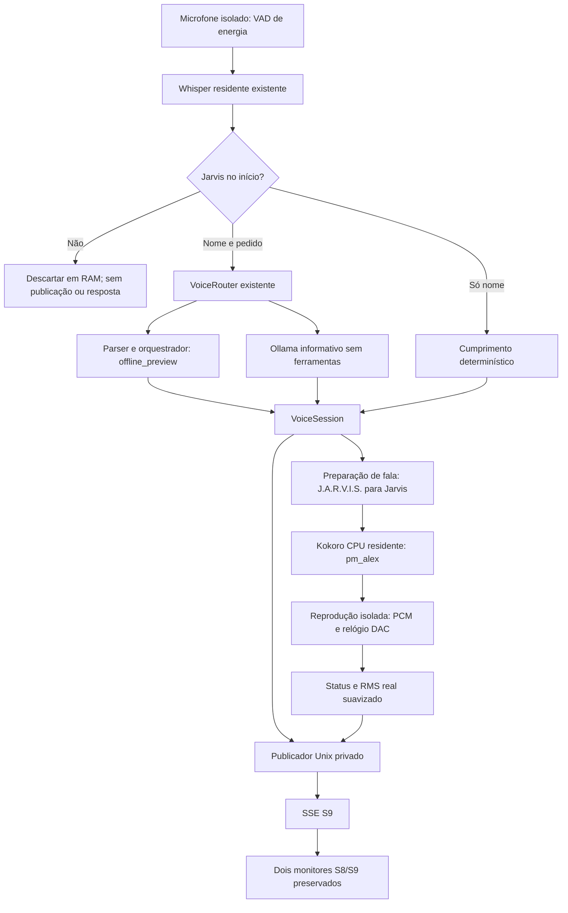

# Sprint 9.1 — vocativo obrigatório, persona e pm_alex

Data: **20/10/2026, America/Bahia**.
Branch: **`feature/sprint9-1-jarvis-wake-persona`**.
Implementação e regressões offline concluídas. **Não é homologação acústica.**
Nenhum comando de push, merge ou PR executado; nenhuma operação física habilitada.

## Resultado

Toda solicitação da `VoiceSession`, manual ou contínua, precisa começar com a
palavra exata **Jarvis**. Falas sem o nome, com nome no meio ou palavras
semelhantes são descartadas antes do `VoiceRouter`, LLM, TTS e callback de
conversa. Não há dispensa nos turnos seguintes. O parser S6/S7.1 continua
reutilizado sem alterações: comandos conhecidos são planos `offline_preview`.

O chamado isolado `Jarvis` produz **“Sim, senhor. Em que posso ajudá-lo?”** de
forma determinística, sem Ollama. A resposta percorre o TTS/apresentação S9 e
volta a IDLE após reprodução/cooldown. O TTS padrão da aplicação é agora
**pm_alex, velocidade 0,92, volume 0,5**, Kokoro CPU brasileiro, com seleção
manual de outras vozes mantida. A persona foi centralmente refinada para
estilo original calmo, técnico, elegante, objetivo e educado, sem imitar atores.

Texto escrito mantém **J.A.R.V.I.S.**. A preparação de fala transforma somente
o nome em **Jarvis** antes da síntese, incluindo formas pontuadas, minúsculas
e espaços entre as letras pontuadas. Outras siglas e palavras permanecem
intactas; não há alteração de frontend, IDs, logs, identidade ou texto da LLM.

| Verificação | Resultado observado nesta implementação |
| --- | --- |
| Baseline Python antes de editar | **885/885**, 2,561 s |
| Regressão Python final | **920/920**, 2,479 s |
| Novos casos Python | **35**: 33 em ativação/fala + 2 na CLI |
| Baseline frontend | **50/50** |
| Frontend final | **52/52**, dois casos novos |
| Playwright | **6/6**, 3,1 s, sem GPU e com SSE falso |
| TypeScript e build Vite | Aprovados |
| Ruff / `git diff --check` | Aprovados |
| Pré-requisitos TTS passivos | `ready=True`, `missing=[]`, voz `pm_alex` |
| Nova inferência/STT/CUDA, síntese ou reprodução reais | Não executadas nesta implementação |
| CI remota S9.1 | Não solicitada/consultada pelo agente; publicação externa observada |

Esses tempos são da suíte, não medições de latência de voz. O operador informou
sucesso real anterior de reconhecimento, respostas, TTS e frontend no Lief.
Esse relato é preservado como homologação anterior da S9; não é uma nova medição
nem certificação de pm_alex/escuta experimental realizada pelo agente.

## Auditoria e ambiente

Árvore inicial limpa em `feature/sprint9-voice-frontend-integration`, HEAD e
upstream **`86222671`**. Branch S9.1 criada desse estado com `--no-track`,
sem reset, troca forçada, descarte ou atualização da base para a main antiga.
A base contém integralmente a S9 e as correções S7.1. Nenhuma alteração local
preexistente estava pendente e nenhum arquivo do operador foi descartado.

Foram examinados sessão, roteador, persona, TTS, STT, CLI, backends, workers
residentes, captura, reprodução PCM, callbacks/publicador de apresentação,
contratos SSE/frontend, testes e guias. Não houve necessidade de outro parser,
cliente LLM, motor STT, transporte ou cena visual.

Conferência passiva por metadados e presença/tamanho dos arquivos:

| Item | Observação |
| --- | --- |
| Kokoro | 0.9.4 |
| Torch | 2.14.1+cpu |
| Faster-Whisper / CTranslate2 | 1.2.1 / 4.8.3 |
| sounddevice | 0.5.6 |
| `config.json` | Presente, 2351 bytes |
| `kokoro-v1_0.pth` | Presente, 327212226 bytes |
| `voices/pm_alex.pt` | Presente, 523425 bytes |
| `voices/pm_santa.pt` | Presente, 523430 bytes |

Diretório conferido: `~/.local/share/jarvis-room/models/kokoro`. O preflight
também encontrou `espeak-ng`. Não importou Torch/Kokoro nativos, abriu áudio,
carregou pesos ou comprovou saída acústica. Nenhum download, treinamento,
instalação, mudança de serviços ou configuração global OpenJarvis foi feita.
Ollama/Qwen 3.5 4B e CUDA mantêm a configuração S9; não houve nova inferência
ou consulta de inventário Ollama nesta implementação.

## Arquitetura e decisões

Antes, uma ativação abria uma janela que aceitava turnos sem vocativo; cada
transcrição válida podia chegar ao roteador. Agora há admissão obrigatória
após STT, com resposta especial para chamado isolado.



`AddressedSpeech` é um contrato de admissão, não um novo interpretador de ações.
Aceita limites de palavra/pontuação explícitos, 256 caracteres, caixa ASCII e
espaços/aspas apropriados; rejeita controles, nome parcial, variantes fonéticas
e nome no meio. Retira somente o vocativo inicial e seus separadores. Não
normaliza `Járvis`, não aceita `Hey Jarvis` como pedido e não transforma a
sigla pontuada no vocativo de entrada. A normalização da sigla é só para saída.

`--continuous-experimental` alterna ciclos limitados de captura VAD + STT
residente, sem Enter. Preparação do STT acontece uma vez antes do primeiro
ciclo; não consome o prazo ativo. Na espera passiva e na transcrição ainda não
ativada, o estado é IDLE; THINKING/RESPONDING só ocorrem após aceitação.
O callback real de abertura do stream informa saúde do microfone. IDLE nesse
modo não significa microfone desligado. No modo manual permanecem os estados
LISTENING/TRANSCRIBING explícitos. Não se adicionaram estados ao contrato SSE.

Pausa padrão entre ciclos de 0,25 s, limitada a 0,2–5 s; silêncio e captura
continuam limitados pela S7. Falha de captura/STT encerra a escuta experimental
com erro e fecha os recursos, em vez de relançar modelos indefinidamente.
TTS indisponível mantém texto. Ctrl+C cancela e libera captura/modelos;
`Jarvis, sair` encerra fora do TTS. Nenhuma captura ocorre durante TTS/cooldown.

Comparação suplementar de eco agora retém no máximo duas respostas do
assistente, preparadas para fala, por timeout da operação + 30 s; elimina
entradas vencidas no próximo ciclo e limpa tudo no fechamento. São apenas
respostas sintetizadas recentes, nunca áudio ou falas ambientais descartadas.
A defesa primária continua a separação dos streams/processos e half-duplex.

O publicador recebe os callbacks existentes. `RESPONDING` sozinho não produz
energia: continua exigido progresso real de reprodução com PCM/RMS e agenda
DAC. Fim/falha/cancelamento zeram amplitude; desconexão invalida estado e
energia no frontend. O cumprimento não é publicado como conversa informativa.
Os seis estados, heartbeat, sequência, reconexão, Unix privado e identidade
visual dos dois monitores foram preservados.

## Arquivos e dependências

Prefixos abaixo relativos a `projects/jarvis-room/`, exceto workflows:

| Arquivo(s) | Alteração |
| --- | --- |
| `src/jarvis_room/voice_activation.py` | Novo contrato tipado de vocativo inicial exato |
| `src/jarvis_room/voice_persona.py` | Persona, cumprimento, defaults e preparação de pronúncia |
| `src/jarvis_room/voice_session.py` | Admissão antes do roteador, ciclo passivo, carga única observada, eco entre ciclos |
| `src/jarvis_room/voice_contract.py` | Pausa passiva limitada/validada |
| `src/jarvis_room/room_voice_cli.py` | Opt-in contínuo, exclusão com detector/chat textual, shutdown e defaults |
| `src/jarvis_room/voice_backends.py`, `voice_tts.py` | Novos defaults e texto preparado só para síntese |
| `tests/test_voice_activation.py` | 33 testes novos com fakes e WAV sintético |
| `tests/test_voice_cli_configuration.py` | Dois casos novos de flags e seleção de voz |
| `tests/test_voice_session.py`, `test_voice_consolidation.py`, `test_room_natural_variants.py` | Fixtures com vocativo e regra nova para turno sem nome |
| `tests/test_voice_backends.py`, `test_voice_playback_events.py` | Assets falsos pm_alex e preservação de testes explícitos pm_santa |
| `frontend/src/data/live.test.ts` | Dois cenários novos de espera/cumprimento e desconexão |
| `.github/workflows/jarvis-room-{unittest,presentation}.yml` (raiz) | Branch S9.1 incluída para futura CI autorizada |
| `README.md`, `docs/integrations/{jarvis-wake-persona,voice-frontend-integration,voice-gpu-ollama,voice-interaction}.md` | Guia novo e comandos/comportamento atualizados |
| `docs/reports/sprint-9-acceptance.md` e este relatório | Referência posterior sem apagar auditoria histórica e evidências S9.1 |

**Nenhuma dependência de runtime adicionada**, nenhum peso/voz novo,
nenhuma mudança em CUDA, Whisper, cliente Ollama, catálogo HA ou cena Three.js.

## Testes e fronteiras de segurança

Mesmos 885 casos anteriores presentes, com ajustes deliberados de fixtures e
expectativas para exigir Jarvis a cada turno; 35 casos novos totalizam 920.
O teste que permitia continuar sem nome passou a exigir descarte do segundo
turno: a mudança de contrato é o objetivo da S9.1, não perda de proteção física.
Fixtures TTS oferecem o novo asset padrão e mantêm testes explícitos de Santa.

Novos testes cobrem: nomes pontuados/case/espaços, texto intacto/outras siglas,
defaults/seleção Santa, chamado fixo sem LLM, perguntas, nome no meio/similar,
vazio/inválido, conversas ambientais, ausência de router/LLM/TTS/histórico e
publicação de descartes, múltiplos turnos, STT preparado uma vez, timeout,
Ctrl+C, pausa cancelada, fechamento, eco entre ativações, privacidade de
métricas, half-duplex e planos offline. Um teste integra cumprimento,
`ResidentSpeaker`, WAV sintético, `play_pcm` e publicador sem transporte,
verificando energia positiva derivada do PCM e zero final, com saída falsa.
A regressão existente cobre adicionalmente DAC, cancelamento/falhas de TTS,
heartbeat, reconexão, amplitude inválida e descarte de eventos antigos.

Falas rejeitadas não são enviadas ao dashboard. A LLM continua sem ferramentas
e suas respostas não são fonte operacional. A admissão do nome não autentica
pessoa nem cria `OperatorTurn`, autorização Samsung ou cliente físico. HA
permanece observação restrita opt-in, sem POST/execução por voz/dashboard.

Python bloqueou hardware, subprocessos reais, sockets e modelos nativos. Vitest
usou transporte/relógio falsos. Playwright usou navegador sem GPU, SSE falso e
servidor local restrito; dependências de teste já presentes em `/tmp`, sem
instalação/download nesta sessão. O aviso conhecido de chunk Three.js ~941 kB
minificado permanece, sem falha de build. Não representa medição de WebGL real.

Durante desenvolvimento um teste detectou substituição parcial indesejada em
`J.A.R.V.I.S.2`; a expressão foi corrigida para preservar esse token integral.
Ruff apontou organização de imports/linhas longas, corrigidas antes da entrega.
Não houve regressão pendente nas verificações finais.

## Execução no Lief

Terminais separados, a partir da raiz `openjarvis`:

```bash
# Terminal 1: backend de apresentação, sem opt-in HA.
PYTHONPATH=projects/jarvis-room/src:src .venv/bin/python -m jarvis_room.presentation_server
```

```bash
# Terminal 2: frontend.
cd projects/jarvis-room/frontend
npm run dev
```

Abrir `http://127.0.0.1:5174/monitor/1` e
`http://127.0.0.1:5174/monitor/2`, selecionando LIVE.

```bash
# Terminal 3: homologação humana da escuta contínua experimental.
PYTHONPATH=projects/jarvis-room/src:src .venv/bin/python -m jarvis_room.room_voice_cli \
  --stt-model-dir "$HOME/.local/share/jarvis-room/models/whisper-large-v3-turbo" \
  --stt-device cuda --stt-compute-type float16 --stt-beam-size 1 \
  --llm --llm-model qwen3.5:4b \
  --tts-backend kokoro --tts-model-dir "$HOME/.local/share/jarvis-room/models/kokoro" \
  --voice pm_alex --speed 0.92 --volume 0.5 \
  --continuous-experimental --passive-pause-seconds 0.25 --presentation --metrics
```

Ctrl+C no terceiro terminal desliga a captura e libera os workers.
Depois do cumprimento é obrigatório dizer Jarvis novamente. Sem o opt-in
contínuo o modo é manual por Enter. O [guia completo](../integrations/jarvis-wake-persona.md)
traz comandos completos para comparação pm_alex/pm_santa sem LLM, diagnóstico,
dispositivos, privacidade e roteiro de medição. Não existem flags de execução
física. Portas mantidas: frontend 5174, SSE 8765, Ollama 11434 e HA 18123 opt-in.

Verificações offline executadas:

```bash
python3.11 projects/jarvis-room/scripts/run_offline_tests.py
.venv/bin/ruff check projects/jarvis-room/src/jarvis_room/voice_*.py \
  projects/jarvis-room/src/jarvis_room/room_voice_cli.py \
  projects/jarvis-room/tests/test_voice_*.py projects/jarvis-room/tests/test_room_natural_variants.py
git diff --check
cd projects/jarvis-room/frontend
npm test
npm run build
LD_LIBRARY_PATH=/tmp/jarvis-s9-browser-libs/extracted/usr/lib/x86_64-linux-gnu \
  PLAYWRIGHT_BROWSERS_PATH=/tmp/jarvis-s9-playwright npm run test:e2e
```

Os caminhos temporários do último comando contêm somente dependências de
teste já preparadas na S9; em outra máquina use seu navegador Playwright
preparado. Nenhuma execução externa de workflow foi solicitada.

## Limitações e pendências humanas

- **Implementado/testado offline:** admissão obrigatória, cumprimento,
  preparação de pronúncia, defaults, loop com STT residente, shutdown,
  pipeline PCM/eventos, ausência de execução física e frontend preservado.
- **Conferido passivamente:** pacotes e arquivos locais TTS, preflight pronto.
  Isso não comprova voz, microfone, GPU ou reprodução real nesta versão.
- **Informado pelo operador:** funcionamento real anterior da S9 no Lief.
- **Não validado nesta entrega:** timbre/naturalidade/pronúncia da nova voz,
  CPU/GPU/VRAM/latência da escuta contínua, falsos aceites/hora/rejeições,
  duração de gaps, eco e sincronização perceptiva no Windows/WSLg.
- **Dependência futura:** detector acústico específico de Jarvis isolado,
  com origem/licença/modelo e corpus brasileiro consentido. O público
  Hey Jarvis não equivale a esse detector. Nenhum download/treino foi feito.

O fallback experimental usa VAD de energia + transcrição de falas detectadas
e filtro textual: não é detector acústico seguro ou barato. Ruído pode causar
inferência e o STT pode alucinar Jarvis. Terceiros/gravações com nome inicial
podem ser aceitos; wake word não autentica autoria. Há gaps durante STT,
reprodução, cooldown e reabertura, e não há barge-in. Tudo continua sem poder
de execução física mesmo em caso de falso aceite.

O guia define ensaio com corpus positivo/negativo, contagens e duração para
falsos aceites/hora, rejeições, latência completa e CPU/RAM/VRAM, sem gravar
conteúdo pessoal por padrão. `voice_admission.accepted` só conta vocativos
textuais válidos, não comprova a intenção real nem representa a medição humana.
Não foram inventadas métricas acústicas ou ganhos de desempenho.

## Git

- Base S9: `86222671`, árvore inicial limpa, upstream S9 igual ao HEAD.
- Branch: `feature/sprint9-1-jarvis-wake-persona`, criada localmente sem upstream.
- Implementação: **`5e4bd9bf`** — `feat: S9.1 require initial Jarvis and prepare pm_alex voice`.
- Documentação: commit local posterior; SHA final informado na entrega e por
  `git rev-parse HEAD`. Nenhuma mudança de código após a regressão final.
- Na conferência final, apareceu upstream da mesma branch em `5e4bd9bf`,
  com reflog `update by push` às **15:36:16 de 20/10/2026, America/Bahia**.
  Nenhum comando de push foi executado pelo agente; essa atualização ocorreu
  fora dos comandos desta sessão e foi preservada. Não se atribui sua autoria.
- Sem push, merge ou PR pelo agente. Não se solicitou execução remota de CI
  nem se consultaram/verificaram resultados dessa publicação externa;
  todos os resultados S9.1 apresentados aqui são locais. Workflows incluem
  a branch S9.1. Estado final conferido após
  registrar a documentação, sem arquivos de trabalho pendentes.
