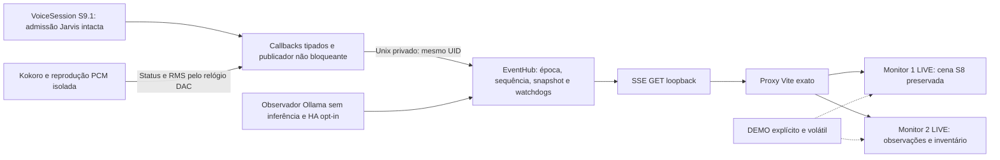

# Sprint 9.2 — integração LIVE do frontend com o backend

Data: **21/10/2026, America/Bahia**.
Branch: **`feature/sprint9-2-live-frontend-backend`**.
Implementação e testes controlados concluídos. **Homologação supervisionada de
voz/Kokoro/GPU/WebGL/HA reais desta versão ainda não executada.**
Nenhum comando físico, push, merge ou PR foi executado pelo agente.

## Resultado

Os dois monitores agora iniciam **LIVE automaticamente**, com uma conexão SSE
por janela. Sem backend/heartbeat ficam desconectados e tentam reconectar,
sem mudar para DEMO. A simulação é uma opção manual, isolada dos dados LIVE.
Não é necessário recarregar as páginas a cada estado ou reinício do backend.

Foi mantido o caminho Python → Unix privado → SSE → proxy Vite → React,
com contrato v2 estrito, sessão, sequência e timestamps. Não foram criadas
outra API, WebSocket, rota de comando ou dependência de runtime. Os controles
de Host/origem, UID/permissões Unix, catálogo e cenas foram preservados.

O Monitor 1 continua com a cena aprovada, núcleo, anéis, partículas, efeitos,
fundo, responsividade e fallback existentes. Recebe estados e energia PCM,
sem envelope sintético em LIVE. Monitor 2 mostra conexão, última observação,
sessão/microfone observado, STT, Ollama, modelo, Kokoro e reprodução. Modelo
instalado é distinto de geração informativa concluída. IDLE não é apresentado
como prova de microfone desligado. Perguntas/respostas continuam ocultas por
padrão, com opt-in CLI e checkbox que é limpo ao desconectar/trocar sessão.

| Verificação | Baseline confirmado | Resultado final |
| --- | --- | --- |
| Python 3.11 | **920/920**, 2,807 s | **954/954**, 2,717 s, incluindo diagnóstico de captura descrito abaixo |
| Vitest | **52/52** | **61/61** |
| Playwright | **6/6**, 2,5 s | **8/8**, incluindo transporte Unix/SSE/Vite real com produtor falso |
| TypeScript | Aprovado | Aprovado |
| Build Vite | Aprovado | Aprovado |
| Ruff | — | Aprovado nos módulos/testes de voz, apresentação e fixture E2E |
| `git diff --check` | Árvore inicial limpa | Aprovado |
| Voz/GPU/LLM/Kokoro/HA reais | Não iniciados no baseline | Não iniciados nesta implementação |

34 testes Python novos (20 de apresentação e 14 do diagnóstico de captura),
nove Vitest novos e dois E2E novos. Os casos anteriores
permanecem, com ajustes de expectativa para LIVE inicial, handshake atual e
semântica de inventário. Os tempos da suíte não medem latência de conversação.

## Base e auditoria

Árvore inicial limpa em `feature/sprint9-1-jarvis-wake-persona`, **`1f105e6c`**,
incluindo implementação `5e4bd9bf` e documentação S9.1. A branch S9.2 foi criada
desse estado com `--no-track`, sem reset, descarte ou troca forçada. A referência
remota da branch S9.2 apareceu posteriormente no mesmo commit base, por operação
externa aos comandos desta sessão; não foi feito push pelo agente.

Auditados servidor, hub, publicador Unix, contrato, observador de saúde,
`VoiceSession`, admissão, TTS, reprodução, CLI, fontes React, tipos, provider,
monitores, controles, cena e configuração Vite/Playwright. O orquestrador,
admissão S9.1, STT, adaptador Ollama e sintetizador foram reutilizados.
Python e ambiente virtual: **3.11.17**; Node **24.22.0**, npm **11.19.1**.
Não se fez nova inspeção de hardware, inventário real Ollama ou áudio para
transformar presença de pacote/modelo em alegação de funcionamento.

## Problemas concretos corrigidos

1. Provider inicializava DEMO. Agora inicializa backend/LIVE, sem persistência
   de escolha anterior nem fallback automático. DEMO só muda por ação explícita.
2. O inventário Ollama marcava o modelo como conectado sem comprovar geração.
   Agora instalado fica `llm=unknown`, com detalhe “instalado; sem resposta
   observada”. `router_complete` confirma geração antes do TTS, sem texto privado.
   Polling não sobrescreve/redata a resposta real; falha do inventário invalida
   evidência e resultados de uma sessão anterior não substituem a nova.
3. O publicador reenviava estados transitórios/energia do cache na reconexão.
   Agora começa em IDLE/saída indisponível/zero e saúde não positiva, sem conversa.
   Progresso positivo/ocupado com mais de 500 ms na fila é descartado. Só PCM
   recente retoma playing; a limpeza de backlog antecede o hello Unix, evitando
   descartar um evento novo emitido durante o handshake. RESPONDING só é
   restaurado se foi emitido pela máquina
   real. Não há transição inventada por LLM ou pelo frontend.
4. Um assinante tardio recebia handshake com horário da criação do backend.
   O snapshot agora confirma a conexão no horário atual e mantém horários das
   observações. Leases/watchdogs são verificados antes da assinatura. Heartbeat/
   handshake velho não mantém uma conexão artificialmente válida no frontend.
5. O watchdog podia expirar antes do primeiro PCM após uma longa espera.
   O prazo começa na transição para playing. ERROR invalida reprodução/energia
   no publicador, hub e receptor React; stop/cancelamento/desconexão zeram também.
6. Datas inválidas podiam ser normalizadas silenciosamente pelo `Date.parse`.
   Calendário ISO, horário, fuso e limites são verificados, mantendo compatibilidade
   com os timestamps válidos do contrato Python.
7. Cada cartão de equipamento assinava todo o fluxo de amplitude. Os nove
   cartões agora recebem observações por props/memo e não têm essas assinaturas
   adicionais. Não foi feito benchmark ou inventado ganho de FPS/latência.

O rótulo genérico **Observado** não significa inferência: servidores S9 antigos
também usavam connected para inventário. A evidência no detalhe/horário emitido
pelo backend é que diferencia modelo instalado e resposta gerada. Nenhum pacote
instalado promove TTS/STT/microfone a operacional.

## Arquitetura e eventos



As duas assinaturas recebem o mesmo conjunto de nove tipos v2, com a mesma
época do backend. Fechar uma janela não fecha a outra nem inicia/encerra IA.
Não se enviam áudio bruto, tokens, logs, ferramentas ou caminhos de modelos.

| Evento | Monitor 1 | Monitor 2 |
| --- | --- | --- |
| `connection` | Badge LIVE/estado do backend | Estado de conexão |
| `heartbeat` | Validade e horário do último evento no tooltip | Validade e última atualização |
| `voice_state` | Cena/estado/tradução | Estado da sessão |
| `playback_status` | Preparação, reprodução ou saída inativa | Reprodução/falha |
| `voice_amplitude` | Núcleo/anéis/brilho pelo parâmetro existente | Amplitude/barras |
| `service_status` | Recebido, sem painel de serviços | Seis serviços com detalhe/horário |
| `device_status` | Recebido, sem painel de equipamentos | Catálogo canônico, sem promoção dos planejados |
| `lab_observation` | Recebido, sem painel de laboratório | Somente helper virtual autorizado |
| `conversation` | Não exibida | Oculta até opt-ins; limpa/oculta na reconexão |

RESPONDING significa preparar/responder, não comprova áudio tocando.
Synthesizing/indisponível não geram amplitude. PCM positivo só é aceito com
playing, dentro dos limites de validade; erro/fim/perda de fonte deixam zero.
Temporização DAC e suavização S9 não foram substituídas. A cena tem animação
decorativa de espera, que não representa energia de voz simulada.

O serviço `voice` descreve sessão/microfone pela última observação. Não existe
novo sensor de abertura contínua no v2; o dashboard explicita esse limite e
não conclui “microfone desligado” a partir de IDLE na escuta experimental.
O modelo nomeado após geração é o selecionado no adaptador local existente.
Isso não comprova GPU, naturalidade, correção da resposta ou estado físico.

## Arquivos alterados

Prefixo `projects/jarvis-room/`, exceto workflows na raiz:

| Arquivo(s) | Finalidade |
| --- | --- |
| `src/jarvis_room/presentation_hub.py` | Snapshot atual, lease, watchdog inicial, invalidação e evidência LLM |
| `src/jarvis_room/presentation_health.py` | Inventário versus inferência, proteção de época e estado HA existente |
| `src/jarvis_room/presentation_ipc.py` | Fila com idade interna, retomada conservadora, observação STT/LLM e erro zero |
| `src/jarvis_room/voice_session.py` | Somente callback de métricas router_complete, duas linhas; admissão/decisão intactas |
| `frontend/src/state.tsx` | LIVE inicial |
| `frontend/src/contracts.ts`, `data/source.ts`, `data/live.ts` | Calendário estrito, fonte inicial honesta, erro zero, validade e reconexão |
| `frontend/src/data/labels.ts` | Novo: rótulos de conexão/reprodução/observações |
| `frontend/src/pages/MonitorOne.tsx`, `MonitorTwo.tsx`, `components/DemoPanel.tsx` | Indicadores discretos, privacidade e cartões sem assinaturas redundantes |
| `frontend/vite.config.ts`, `playwright.config.ts` | Portas exclusivas E2E, sem reutilizar os serviços operacionais |
| `frontend/src/data/live.test.ts`, `src/state.test.tsx` | Nove casos Vitest novos, incluindo provider LIVE inicial |
| `frontend/tests/monitors.spec.ts` | Seis cenários anteriores adaptados para DEMO explícito/LIVE inicial |
| `frontend/tests/backend_fixture.py`, `live-transport.spec.ts` | Novos: transporte real local com produtor falso e controle só por stdin |
| `tests/test_presentation_live.py` | Novo: 20 casos Python offline |
| `tests/test_presentation_integration.py` | Clock determinístico do handshake e expectativa de inventário atualizado |
| `.github/workflows/jarvis-room-{unittest,presentation}.yml` | Branch S9.2, Python 3.11 para E2E, Ruff da fixture e gatilhos de backend |
| `README.md`, `frontend/README.md`, `docs/integrations/{presentation-events,voice-frontend-integration,jarvis-wake-persona}.md` | Comportamento atual, comandos e roteiro |
| Este relatório | Evidências, arquivos, limites e Git |

**Dependências de runtime adicionadas: nenhuma.** Package.json/lock, catálogos,
cenas, assets, CSS e todo `src/scene/` permanecem sem alterações. Não foi
recriado o holograma, nem foram adicionadas imagens/vídeos/animações substitutas.

## Evidência dos testes

Python: **940 = 920 + 20**, com hardware, sockets, processos externos e backends
nativos proibidos pelo runner. Cobertura nova inclui snapshot tardio/lease,
watchdog, ERROR/PCM, inventário versus geração, corrida de sessão, confirmação
antes do TTS sem compartilhar conversa, fila atrasada, retomada de PCM recente,
ausência de transição inventada, privacidade e limites de identificadores.

Vitest: **61 = 52 + 9**. Acrescenta LIVE inicial, calendário inválido, heartbeat/
handshake atrasados/futuros, reinício e época anterior, estado de reconexão,
ERROR sem energia, DEMO isolado e metadados reais versus modelo presumido.

Playwright: **8 = 6 + 2**. Os novos casos usam Python **3.11**, classes reais do
servidor/hub/publicador de produção, socket Unix privado, SSE, proxy Vite
e EventSource do navegador.
O produtor/serviços/áudio são **falsos**. Confirma LIVE inicial nas duas janelas,
seis estados, síntese sem energia, playing/amplitude, zero final, fechamento de
uma janela, reconexão do publicador sem ressuscitar energia, encerramento
do produtor, backend conectado sem sessão, reinício
de backend e recuperação sem reload. A conversa volta a ficar oculta.
O harness inicialmente esperava somente 3 s pela reconexão do publicador;
a espera de heartbeat (até 2 s) + backoff (2 s) exigiu prazo de teste compatível
(6 s). O timeout do produto não foi aumentado para fazer o teste passar.
Isso valida transporte/interface controlados, não microfone, modelos ou som.

Falhas ambientais tratadas: o Chromium temporário S9 já não existia, e depois
faltaram libnspr4/libnss3. Chromium headless build 1248 e FFmpeg de testes foram
preparados em `/tmp/jarvis-s92-playwright`; pacotes libnspr4 `2:4.35-1.1build1`
e libnss3 `2:3.98-1ubuntu0.2` foram baixados/extraídos em
`/tmp/jarvis-s92-browser-libs`, **sem instalar no sistema**. Não são modelos de IA.
Com isso o baseline seis E2E passou antes de editar o código.

A primeira integração completa abortou porque **8765 já estava ocupada**.
Não se encerrou nem reutilizou esse processo. O harness agora usa **15174/18765**
no loopback e controla apenas seus filhos. Não há listeners dessas portas após
os testes; encerramento do produtor/backend é aguardado. Os parâmetros normais
5174/8765 e as configurações globais do WSL/serviços não foram alterados.

TypeScript/build e Ruff aprovados. Aviso conhecido de chunk Three.js ~941 kB
minificado permanece; não é falha de build nem medição de desempenho. Fixtures
e builds não importam modelos nativos, chamam Ollama/HA ou gravam áudio.
Não se solicitou CI remota, pois não houve publicação de mudanças pelo agente.

## Comandos completos no Lief

Da raiz `openjarvis`, em terminais separados. Pare/reinicie manualmente seus
processos Python antigos para carregar a nova versão; não remova sockets em uso.

```bash
# Terminal 1 — apresentação, HA desabilitado.
PYTHONPATH=projects/jarvis-room/src:src .venv/bin/python -m jarvis_room.presentation_server
```

```bash
# Terminal 2 — frontend operacional.
cd projects/jarvis-room/frontend
npm run dev
```

Abrir `http://127.0.0.1:5174/monitor/1` e
`http://127.0.0.1:5174/monitor/2`: LIVE conecta automaticamente.

```bash
# Terminal 3 — voz real somente na homologação supervisionada.
PYTHONPATH=projects/jarvis-room/src:src .venv/bin/python -m jarvis_room.room_voice_cli \
  --stt-model-dir "$HOME/.local/share/jarvis-room/models/whisper-large-v3-turbo" \
  --stt-device cuda --stt-compute-type float16 \
  --llm --llm-model qwen3.5:4b \
  --tts-backend kokoro --tts-model-dir "$HOME/.local/share/jarvis-room/models/kokoro" \
  --voice pm_alex --speed 0.92 --volume 0.5 \
  --continuous-experimental --presentation --metrics
```

Ctrl+C no terminal 3 fecha captura e workers; no terminal 1 fecha backend e seu
socket. Não se inicia áudio pelas telas. Sem o modo contínuo, Enter abre captura
manual; o vocativo continua obrigatório em cada fala. Não iniciar uma CLI por monitor.

Testes executados:

```bash
python3.11 projects/jarvis-room/scripts/run_offline_tests.py
.venv/bin/ruff check projects/jarvis-room/src/jarvis_room/presentation_*.py \
  projects/jarvis-room/src/jarvis_room/voice_*.py \
  projects/jarvis-room/src/jarvis_room/room_voice_cli.py \
  projects/jarvis-room/tests/test_presentation_*.py \
  projects/jarvis-room/tests/test_voice_*.py \
  projects/jarvis-room/frontend/tests/backend_fixture.py
git diff --check
cd projects/jarvis-room/frontend
npm run typecheck
npm test
npm run build
LD_LIBRARY_PATH=/tmp/jarvis-s92-browser-libs/extracted/usr/lib/x86_64-linux-gnu \
  PLAYWRIGHT_BROWSERS_PATH=/tmp/jarvis-s92-playwright npm run test:e2e
```

Em ambiente com Playwright preparado, o último comando é simplesmente
`npm run test:e2e`. O modo Vite e2e é exclusivo do harness; os serviços falsos
não são uma fonte operacional da Sala Temática.

## Segurança, limitações e homologação

Nenhuma ação física foi habilitada. Voz, LLM, dashboard e cenas continuam sem
executor. Não foram criados `OperatorTurn`, tokens, permissões Samsung, chamadas
POST HA ou ferramentas físicas para o modelo. O observador HA padrão não faz
GET; somente opt-in existente permite observar o helper virtual, sem promovê-lo
a iluminação real ou assumir conexões Samsung/WLED/Hikvision/clima/áudio.

A admissão S9.1 permanece intacta: Jarvis inicial exato em cada pedido, chamado
isolado determinístico e falas não ativadas fora de router/LLM/TTS. A variante
transcrita **J.A.R.V.I.S.** ainda pode ser rejeitada. Essa pendência não foi
contornada no frontend nem resolvida com filtro permissivo; exige homologação
específica. Wake word não autentica pessoa. Half-duplex, cancelamento, DAC e
processos de áudio separados continuam os existentes.

Revisão de origem/Host e UID não autentica código malicioso do mesmo usuário.
Timestamps de navegação/WSL precisam ser coerentes para validade; observação
de serviço não é verificação física contínua. Não foram feitas medições novas
de GPU, latência acústica, jitter, qualidade da voz ou fluidez WebGL.

O [roteiro supervisionado completo](../integrations/voice-frontend-integration.md)
inclui: iniciar backend/frontend, conferir LIVE automático, iniciar uma única
CLI, dizer Jarvis/quem é você/pergunta informativa, conferir estados, ouvir
Kokoro e avaliar sincronização real; parar/reiniciar o próprio backend sem
reload, fechar uma janela, encerrar CLI e conferir IDLE/zero. Inclui privacidade,
rejeição conhecida da sigla e HA desabilitado. **Foi preparado, não executado
com equipamentos reais nesta entrega.**

## Investigação posterior: `microphone: capture_limit` (21/10/2026)

O operador forneceu um log de homologação: STT CUDA/float16 inicializado em
1,764 s (worker em 2,351 s), seguido de `capture_limit`. Esses tempos vêm do
log do operador; não são novas medições executadas pelo agente nem latência
total do turno. O erro é emitido pelo VAD de energia após início de fala sem
silêncio suficiente antes do limite. Não equivale a erro de carregamento CUDA.
Não foi confirmado se a causa acústica é ruído, ganho, duração da fala ou outra.

Consultas reais **sem captura** confirmaram dispositivo PortAudio 0 `pulse`,
entrada padrão PulseAudio `RDPSource`, não `RDPSink.monitor`, sem mute e com
volume 100%. Isso não comprova qualidade da entrada. `--diagnose` confirmou
dependências presentes e preservou `capture_performed=false`. Nenhuma fonte,
permissão, volume ou configuração Windows/WSL foi alterada.

Foi acrescentado `--measure-input-levels`, opt-in separado dos diagnósticos
passivos e da sessão. O worker de captura CPU existente recebe a operação
`input_levels` e mede por 1–10 s (padrão 5), com cancelamento e fechamento do
stream. Só retornam estatísticas RMS e contagens; áudio não é persistido,
transcrito ou publicado. Ausência de quadros retorna `audio_no_frames`. A
mensagem de `capture_limit` agora indica medição e inspeção de ruído/ganho.
Continuam o descarte integral da captura cortada e a parada da escuta após falha;
nenhum retry ilimitado ou envio de frase incompleta foi habilitado.

Arquivos adicionais modificados nesta investigação: `voice_audio.py`,
`voice_contract.py`, `voice_worker.py`, `room_voice_cli.py`, `voice_session.py`,
`test_voice_audio.py`, `test_voice_backends.py`, `test_voice_activation.py`,
`test_voice_cli_configuration.py`, guia de integração e este relatório.
Nenhuma dependência nova. Novos testes: seis de estatísticas/limites/limpeza,
seis de CLI/opt-in/falhas/cancelamento, um de dispatch e fechamento do worker,
um de parada segura sem STT/LLM/TTS. Baseline desta investigação: **940/940**,
2,608 s; resultado **954/954**, 2,717 s. Ruff e `git diff --check` aprovados.
Frontend não foi alterado nesta investigação; os resultados frontend/E2E da
tabela são da validação S9.2 anterior, não de uma nova execução.

O [guia](../integrations/voice-frontend-integration.md#captura-descartada-por-falta-de-silêncio)
traz os comandos completos para medir silêncio e fala. A medição com microfone
**não foi executada pelo agente**: aguarda operador e resultados antes de
selecionar outro limiar. Não se afirma correção acústica ou nova homologação.

## Git e estado da entrega

- Base e HEAD de referência: **`1f105e6c`**, Sprint 9.1; árvore inicial limpa.
- Branch de trabalho: **`feature/sprint9-2-live-frontend-backend`**.
- Alterações S9.2 mantidas na árvore de trabalho para revisão, **sem novo commit**.
  A referência remota observada continua no commit base; não inclui este diff.
- Nenhum comando de push, merge ou PR executado pelo agente. Não se modificaram
  referências ou arquivos preexistentes para descartar trabalho do operador.
- CI preparada, sem execução remota solicitada/resultado atribuído a este diff.
  Resultados relatados são locais. A lista de arquivos é o `git status` final.
