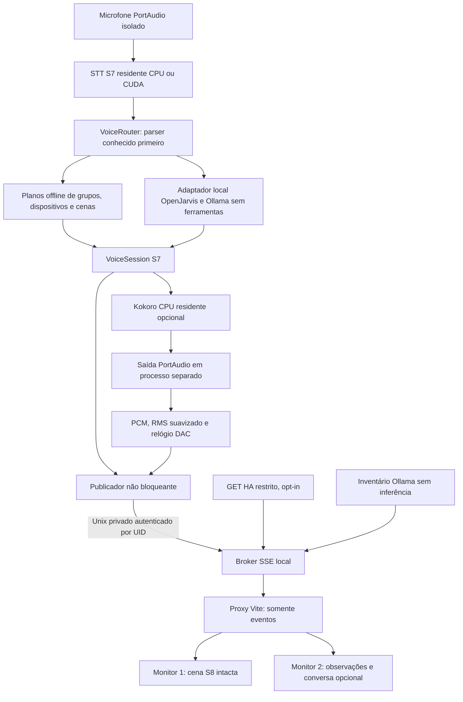

# Sprint 9 — integração da voz com os dois monitores

**Atualização posterior S9.1:** veja o [relatório próprio](sprint-9-1-acceptance.md)
e o [guia operacional atual](../integrations/jarvis-wake-persona.md).
O operador informou testes reais bem-sucedidos da S9 no Lief após esta entrega;
o registro abaixo preserva o estado observado originalmente.

Data: **20/10/2026, America/Bahia**.
Branch: `feature/sprint9-voice-frontend-integration`.
Estado: implementação e verificações offline concluídas; homologação real
de voz, GPU, Kokoro e HA continua pendente. **Não é aceite acústico final.**
Não executei comandos de push, PR ou merge. Nenhuma execução física habilitada.
Uma atualização remota externa foi detectada na conferência final; detalhes em Git/CI.

## Resultado executivo

Os estados da `VoiceSession` S7 e a reprodução do `ResidentSpeaker` alimentam
uma ponte Python → socket Unix privado → SSE → React. As duas rotas S8 foram
preservadas; não se recriaram a sala, o holograma, anéis, partículas ou fundo.
LIVE usa eventos reais da sessão, sem gerar fala/energia demonstrativa. DEMO
continua independente. Desconexão, heartbeat vencido e troca de sessão limpam
observações e amplitude. Não há parsing das mensagens do terminal.

STT, Ollama/Qwen 3.5 4B, histórico e Kokoro reutilizam a implementação S7.
Energia de TTS é calculada do PCM efetivamente enviado à saída, com agenda pelo
relógio DAC do PortAudio; não é emitida antecipadamente na síntese. Microfone
continua fechado durante resposta/cooldown. Falha de TTS mantém texto e energia
zero. O backend pode observar somente o auxiliar HA virtual autorizado.

| Verificação | Resultado |
| --- | --- |
| Baseline Python, antes de editar | **831/831**, 2,190 s |
| Regressão Python final | **885/885**, 831 preservados + 54 novos |
| Baseline frontend | **34/34** |
| Vitest final | **50/50**, 34 preservados + 16 novos |
| Playwright | **6/6**, incluindo duas janelas LIVE e DEMO |
| TypeScript/build | Aprovados |
| Ruff / `git diff --check` | Aprovados |
| Transporte local sem voz/HA | SSE 200, origem externa 403, socket 0600/diretório 0700, encerramento confirmado |
| Hardware de voz, LLM gerando respostas e HA autenticado | Não executados nesta entrega |

## Auditoria inicial

A árvore estava limpa em `main`, commit **`b8b4e318`**, merge da Sprint 8.
`git fetch origin main` confirmou a base atualizada, sem divergência. A branch
S9 foi criada dessa revisão antes de editar. Não houve reset, descarte, mudança
de branch forçada ou perda de trabalho local. A S7/S7.1 já estava integrada à
main pelo PR #16 e foi preservada.

Foram lidos contrato de apresentação S8, frontend/fontes/estados/cena/testes,
`VoiceSession`, `VoiceRouter`, `ResidentSpeaker`, worker/residência/áudio,
CLI/diagnósticos, cliente HA somente leitura, validação de token/estado e
catálogo/cenas. Não há justificativa para criar outro interpretador ou cliente
de inferência. A ponte usa callbacks tipados, não stdout do operador.

### Ambiente efetivamente observado

| Item | Observação |
| --- | --- |
| Python | Ambiente virtual Python 3.11 existente |
| Node / npm | 24.22.0 / 11.19.1 |
| Vite / React / TypeScript do projeto | 8.3.1 / 19.3.0 / 7.0.2 |
| Faster-Whisper / CTranslate2 | 1.2.1 / 4.8.3 |
| sounddevice / soundfile | 0.5.6 / 0.14.0 |
| ONNX Runtime | 1.31.0 |
| Ferramentas presentes | ollama, pactl, espeak-ng, nvidia-smi |
| Modelos STT locais | whisper-large-v3-turbo e whisper-tiny |
| Kokoro / Torch | **Ausentes** |
| Assets Kokoro | config.json, kokoro-v1_0.pth e voices/pm_santa.pt **ausentes** no diretório esperado |
| Opt-in HA no ambiente | Desabilitado |

Consulta passiva real ao Ollama: serviço **0.40.6**, endpoint fixo
`http://127.0.0.1:11434`, sem modelo carregado no inventário de processos.
`qwen3.5:4b` instalado, **3.324.173.934 bytes**, GGUF Q4_K_M, metadados 4.2B,
digest `d8b0f5e9760cd1682034f292d7ef72ec46f432149be0df7574bf2d6e92e38c04`.
O 0.8B também permanece instalado. Não houve pull ou inferência real.
Os parâmetros de contexto permanecem limitados pela S7, não pelo máximo anunciado
no model card. Presença de `nvidia-smi`/CUDA configurável não é nova validação de GPU.

`tts_prerequisites` retornou `ready=false`, faltando `kokoro`, `torch` e
`local_assets`. O código prepara `pm_santa`, mas não pode produzir fala real
neste ambiente até instalação/preparação explicitamente autorizadas. Não
baixamos pesos, vozes ou modelos acústicos, nem instalamos pacotes no sistema.

## Arquitetura implementada



São processos distintos para backend, CLI de voz e frontend. O backend não
carrega STT/LLM/TTS. As janelas são assinantes do mesmo broker e não iniciam
inferência. Há um produtor de voz por backend; uma segunda conexão não ganha
publicação. A autenticação Unix usa `SO_PEERCRED` e UID igual ao do processo.
Não se oferece endpoint de publicação ao navegador.

O envelope v2 reaproveita os estados e campos S8, adicionando época UUID,
heartbeat, reprodução, detalhes sanitizados de serviço, auxiliar virtual e
conversa opt-in. Python e TypeScript rejeitam campos extras e tipos inválidos.
V1 permanece no receptor isolado para compatibilidade; o transporte LIVE só
aceita v2. V2 não publica sensores físicos ainda não observados.

Filas limitadas: publicador 64, assinante 128, quadro Unix até 8192 bytes; no
máximo seis assinantes, oito handlers HTTP e dois Unix. Snapshot apenas atual,
sem log/replay de conversas ou ações. Cada conexão de produtor cria nova época;
sequência cresce dentro dela. Lease vencido não permite ao produtor antigo
invalidar seu substituto. Heartbeat é publicado a cada 2 s, frontend expira em
8 s, lease do produtor em 6 s. Watchdogs são verificados sem bloquear o áudio.

## TTS e sincronização

`ResidentSpeaker` mantém o Kokoro CPU residente. Na rota com apresentação,
reutiliza `ResidentWorker` para um worker de reprodução CPU temporário, com
frames de progresso enquadrados no mesmo pipe privado e mesmo ID da operação.
O resultado final vem depois da reprodução. Cada progresso privado leva
timestamp monotônico; o supervisor descarta playing/energia positiva atrasados
mais de 500 ms, preservando sempre fim/zero. Esse timestamp não é enviado à UI. Timeouts/cancelamento encerram e
aguardam o filho. O guard de morte do pai continua aplicado aos workers.

Reprodução recebe WAV PCM16 mono 24 kHz validado e limitado a 30 s. Callback de
40 ms aplica volume e calcula RMS/32768, suavizado por ataque 0,65/liberação
0,25, limitado a 0–1. Usa fila local; não faz I/O de rede/pipe dentro do callback.
Eventos são agendados pelo `outputBufferDacTime` em relação ao relógio atual
do stream. Só então começam `playing` e a energia visual. Não há publicação
integral da curva enquanto o modelo ainda sintetiza.

`RESPONDING` continua sendo o estado real da resposta; é distinto de saída
acústica ativa. `synthesizing`, falha ou indisponibilidade não autorizam energia
positiva. Encerramento normal, falha, cancelamento e timeout forçam zero. O
frontend também expira energia sem progresso, rejeitando amplitude muito antiga.
Não envia WAV, PCM ou transcrição contínua ao dashboard.

Cena, geometria, anéis, partículas e assets aprovados não foram modificados.
O mesmo parâmetro de energia S8 já controla núcleo, escala, anéis e brilho com
suavização. Respeitam-se movimento reduzido e fallback SVG. A avaliação de
sincronia perceptiva, WSLg/Windows, volume, eco e WebGL real fica pendente.

Half-duplex permanece: captura/detector fechados durante síntese e reprodução,
cooldown S7 e fila nova na captura seguinte. Não houve inclusão de full-duplex
ou autorização por wake word.

## Monitor 2 e Home Assistant

O dashboard mostra estado de voz, status de reprodução e seis serviços, com
horário da última observação. Disponibilidade Ollama/modelo significa resposta
ao inventário e modelo instalado, não certificação de inferência. STT conectado
registra carga observada, não inspeção contínua da GPU ociosa.

O painel de laboratório é separado do inventário físico. Usa exclusivamente
`HALabReadOnlyClient` para GET de **`input_boolean.jarvis_lab_light`** em
**`http://127.0.0.1:18123`**, com opt-in de variável/flag e arquivo privado
validado conforme S3. Não há POST, redirects, proxies, token no frontend ou
consulta de entidades Samsung presumidas. Falha remove o estado observado;
sem opt-in, o serviço permanece desconhecido/leitura desabilitada.

Não foi realizado GET real HA: não havia opt-in ativo e essa homologação exige
operador. O auxiliar virtual não é iluminação física e não promove o registro
planejado `room_main_lights`. Catálogo e cenas continuam os JSON existentes;
nenhuma temperatura, presença ou consumo foi inventado.

Conversa: nada publicado por padrão. `--share-conversation` na CLI autoriza
somente respostas informativas; o operador ainda seleciona exibição no Monitor
2. Pergunta até 256 e resposta até 700 caracteres; apenas último par em memória,
limpo na desconexão. React renderiza texto, sem executar HTML. Não foi adicionado
campo de entrada ou endpoint de inferência do navegador. A LLM permanece sem
ferramentas e suas respostas não voltam ao parser.

## Arquivos criados e modificados

Prefixo `projects/jarvis-room/`, exceto workflows indicados pela raiz:

| Caminhos | Situação e função |
| --- | --- |
| `src/jarvis_room/presentation_contract.py` | Novo: validação v2, JSON restrito e catálogo canônico |
| `src/jarvis_room/presentation_hub.py` | Novo: época, sequência, fan-out, cache limitado, lease e watchdogs |
| `src/jarvis_room/presentation_ipc.py` | Novo: publicador não bloqueante, socket privado e autenticação UID |
| `src/jarvis_room/presentation_server.py` | Novo: SSE GET loopback, ingresso Unix privado, lifecycle e origem/Host |
| `src/jarvis_room/presentation_health.py` | Novo: inventário Ollama e cliente HA existente somente leitura |
| `src/jarvis_room/voice_playback.py` | Novo: saída PCM, RMS, suavização e agenda DAC |
| `src/jarvis_room/room_voice_cli.py` | Flags/callbacks apresentação, privacidade e preflight TTS |
| `src/jarvis_room/voice_session.py` | Callback tipado da resposta, sem alterar decisão operacional |
| `src/jarvis_room/voice_tts.py` | Pré-requisitos, observador e worker de reprodução isolado |
| `src/jarvis_room/voice_resident.py`, `src/jarvis_room/voice_worker.py`, `src/jarvis_room/voice_contract.py` | Progresso tipado no pipe, worker playback e códigos sanitizados |
| `frontend/src/data/live.ts`, `frontend/src/data/live.test.ts` | Novos: SSE, reconexão/heartbeat/energia e 16 testes |
| `frontend/src/data/source.ts`, `frontend/src/contracts.ts` | Validação v2, isolamento DEMO/LIVE e tipos de payload |
| `frontend/src/state.tsx`, `frontend/src/components/DemoPanel.tsx` | Seleção LIVE, descarte e controles DEMO preservados |
| `frontend/src/pages/MonitorOne.tsx`, `frontend/src/pages/MonitorTwo.tsx`, `frontend/src/styles.css` | Estado/energia reais e painéis discretos de laboratório/conversa |
| `frontend/vite.config.ts` | Proxy exato, pré-bundle dos imports 3D e cache próprio |
| `frontend/playwright.config.ts`, `frontend/tests/monitors.spec.ts` | GPU desativada, SSE falso e seis cenários |
| `tests/test_presentation_integration.py`, `tests/test_voice_playback_events.py` | Novos: 37 + 15 testes Python |
| `tests/test_voice_cli_configuration.py` | Dois testes novos de opt-in/callbacks/lifecycle |
| `.github/workflows/jarvis-room-presentation.yml` (raiz) | Novo: Vitest/build/E2E falso na CI futura |
| `.github/workflows/jarvis-room-unittest.yml` (raiz) | Branch S9 e Ruff dos novos módulos/testes |
| `docs/integrations/voice-frontend-integration.md` | Novo: arquitetura, operação, diagnóstico e homologação |
| `docs/integrations/supervised-physical-automation.md` | Novo: fronteiras/procedimento futuro, sem executor |
| `docs/integrations/presentation-events.md`, `docs/adr/0007-dual-monitor-presentation.md` | Contrato atual e referência preservando o registro S8 |
| `README.md`, `frontend/README.md` e este relatório | Execução, resultados e pendências |

**Dependências de runtime adicionadas: nenhuma.** Backend usa stdlib; frontend
usa EventSource nativo. Nenhuma mudança em package.json/package-lock ou pesos.
Kokoro/Torch continuam opcionais e ausentes.

## Testes e falhas corrigidas

Python: **885 = 831 + 54**, execução local observada em 2,427 s. Arquivos novos: 37 testes de
contrato/hub/HTTP/Unix/HA/publicador, 15 de PCM/agenda DAC/cancelamento/IPC/TTS,
mais dois de CLI. Baseline anterior preservada. Runner bloqueia sockets,
subprocessos reais, modelos nativos, áudio, GPU e equipamentos.

Vitest: **50 = 34 + 16**; fake EventStream, relógio virtual, handshake/época,
sequência, reconexão, heartbeat, descarte de callbacks antigos, expiração de
amplitude, privacidade, status e independência DEMO. Build/typecheck aprovados.

Playwright: **6/6 em 2,5 s**. Três cenários S8 preservados, adaptação do antigo
receptor futuro para falha LIVE segura e dois cenários novos: ambas as telas em
LIVE e conversa escondida até opt-in. SSE falso, WebGL desabilitado, movimento
reduzido, GPU desativada e requests externos bloqueados. Não equivale à sessão
acústica ou teste WebGL/hardware real.

A primeira tentativa foi bloqueada por falta do Chromium; a seguinte identificou
`libnspr4.so`/`libnss3.so` ausentes. Chromium headless build 1248 e FFmpeg de teste
foram preparados em `/tmp/jarvis-s9-playwright`; pacotes libnspr4
`2:4.35-1.1build1` e libnss3 `2:3.98-1ubuntu0.2` foram apenas baixados e extraídos
em `/tmp/jarvis-s9-browser-libs`, **sem instalação no sistema**. Não são modelos
de IA nem dependências novas da aplicação.

O navegador então identificou HTTP 504 nos imports 3D carregados tardiamente.
Pré-bundle explícito e cache Vite específico corrigiram a inicialização; teste
isolado e depois os seis cenários passaram. A cena visual não foi recriada.
O aviso de chunk Three.js ~941 kB minificado continua conhecido; não é falha de
build nem nova medição de desempenho GPU.

Ruff passou nos módulos/testes de voz e apresentação. `git diff --check` passou.
Workflows foram atualizados/preparados. Não executei push nem solicitei execução
remota. Na conferência final, a referência de acompanhamento já apontava para
`c1325620`, com reflog `update by push` às 13:05:29 de 20/10/2026 (America/Bahia),
fora dos comandos desta sessão. Não há hooks Git instalados. Preservei essa
atualização e consultei os resultados apenas para informar o estado real.

[CI Python de c1325620](https://github.com/JotakuGr/jarvis-room-private/actions/runs/39454354175):
884 testes em 2,662 s e Ruff aprovados.
[CI de apresentação de c1325620](https://github.com/JotakuGr/jarvis-room-private/actions/runs/39454354292):
aprovada, incluindo seis E2E em 5,2 s. Essas execuções **não cobrem os commits
locais posteriores**, que têm 885 testes Python e verificações locais aprovadas.

## Evidência de transporte realmente executada

Foi iniciado temporariamente o backend real em `127.0.0.1:8765`, usando socket
de verificação `/tmp/jarvis-s9-smoke/events.sock`, sem produtor de voz ou opt-in HA.
Leitura HTTP local confirmou:

- `200`, `Content-Type: text/event-stream; charset=utf-8`, `Cache-Control: no-store`.
- Eventos v2 com sequência crescente e status honestos: voice/STT/TTS
  indisponíveis, Ollama acessível, Qwen selecionado instalado, HA desconhecido.
- Origem `https://other.example` recebeu `403` antes de assinar.
- Diretório Unix 0700 e socket 0600.
- Ctrl+C encerrou o processo com código zero e removeu o socket.

Não foram injetados estados de fala falsos nesse backend. A demonstração de
eventos de voz/reprodução ocorre apenas nas suítes com fakes. Não houve gravação,
GPU/inferência, síntese, reprodução ou consulta/ação HA na verificação real.

## Segurança

Toda transcrição operacional segue o parser/orquestrador existentes e permanece
`offline_preview`. Não se cria `OperatorTurn` autorizado, cliente físico, token,
script HA ou nova permissão Samsung. Cenas e cliques continuam apenas prévias.
O navegador não possui endpoint de comando, autorização ou entrada LLM.

Ollama informativo reutiliza o adaptador e a política de memória S7. Não recebe
ferramentas físicas. Conteúdo/histórico/saída LLM não são origem operacional.
Eventos de apresentação não aceitam campos de execução ou comprovação física.
Credenciais ficam no backend; mensagens de erro/saúde não publicam exceções cruas.

Autenticação por UID protege o ingresso Unix contra outros usuários, não contra
código malicioso sob o mesmo UID. Loopback/checagem de origem não autentica
processos locais de leitura; compartilhar conversa é opt-in e pressupõe máquina
local confiável. Wake word não autentica pessoa. Nenhuma dessas fronteiras é
apresentada como permissão para controle.

O [procedimento futuro](../integrations/supervised-physical-automation.md) separa
identidade verificada, plano/ação tipados, autorização explícita vinculada,
nonce/TTL/idempotência, vínculos atuais de entidades, auditoria mínima e
verificação física independente. Não foi criado um executor com esses poderes.

## Comandos exatos

Da raiz `openjarvis`, em terminais separados:

```bash
# Terminal 1: backend local, sem captura/inferência ou acesso HA padrão.
PYTHONPATH=projects/jarvis-room/src:src .venv/bin/python -m jarvis_room.presentation_server
```

```bash
# Terminal 2: frontend.
cd projects/jarvis-room/frontend
npm run dev
```

Abra `/monitor/1` e `/monitor/2` em `http://127.0.0.1:5174` e selecione LIVE.
Uma sessão de voz, **somente na homologação supervisionada autorizada**:

```bash
# Terminal 3, raiz do repositório: STT/LLM com saída textual inicial.
PYTHONPATH=projects/jarvis-room/src:src .venv/bin/python -m jarvis_room.room_voice_cli \
  --stt-model-dir "$HOME/.local/share/jarvis-room/models/whisper-large-v3-turbo" \
  --stt-device cuda --stt-compute-type float16 \
  --llm --llm-model qwen3.5:4b --tts-backend none --presentation --metrics
```

Após autorização/preparação Kokoro, substituir `--tts-backend none` por
`--tts-backend kokoro --tts-model-dir "$HOME/.local/share/jarvis-room/models/kokoro"
--voice pm_santa --speed 1.0 --volume 0.7`. Comando completo e roteiro no
[guia de integração](../integrations/voice-frontend-integration.md).

Opt-in de conversa: acrescentar `--share-conversation`, depois habilitar exibição
no Monitor 2. Isso não habilita controle ou entrada de texto pelo navegador.

HA, **somente quando sua leitura estiver supervisionada/autorizada**, no lugar
do comando do backend sem opt-in:

```bash
JARVIS_HA_LAB_READ=1 PYTHONPATH=projects/jarvis-room/src:src \
  .venv/bin/python -m jarvis_room.presentation_server \
  --read-lab --ha-token-file "$HOME/.config/jarvis-room/ha-lab.token"
```

Arquivo precisa existir fora do Git, dono correto e modo 0400/0600; token nunca
é argumento textual ou payload. Não assume helper criado/entidade real observada.

Diagnóstico e testes:

```bash
PYTHONPATH=projects/jarvis-room/src:src .venv/bin/python -m jarvis_room.room_voice_cli --diagnose
PYTHONPATH=projects/jarvis-room/src:src .venv/bin/python -m jarvis_room.room_voice_cli --diagnose-ollama
python3.11 projects/jarvis-room/scripts/run_offline_tests.py
.venv/bin/ruff check projects/jarvis-room/src/jarvis_room/presentation_*.py \
  projects/jarvis-room/src/jarvis_room/voice_*.py \
  projects/jarvis-room/src/jarvis_room/room_voice_cli.py \
  projects/jarvis-room/tests/test_presentation_*.py \
  projects/jarvis-room/tests/test_voice_*.py
git diff --check
cd projects/jarvis-room/frontend
npm test
npm run build
npm run test:e2e
```

Com as dependências temporárias desta sessão, prefixar E2E com
`LD_LIBRARY_PATH=/tmp/jarvis-s9-browser-libs/extracted/usr/lib/x86_64-linux-gnu
PLAYWRIGHT_BROWSERS_PATH=/tmp/jarvis-s9-playwright`.

Portas normais: 5174 frontend, 8765 SSE, 11434 Ollama existente e 18123 HA opt-in.
IPC de publicação padrão `/tmp/jarvis-presentation-UID/events.sock`, sem porta
pública. O backend temporário da verificação foi encerrado; não é um serviço
instalado/permanente.

## Limitações e próximos passos

1. Preparar Kokoro/Torch e assets locais autorizados. Só então avaliar pm_santa,
   alternativas brasileiras, inteligibilidade, nomes da sala e naturalidade.
2. Autorizar/testar microfone/STT/LLM reais com LIVE, múltiplos turnos, silêncio,
   Ctrl+C e recuperação. Medir coexistência GPU e latência completa, sem usar
   medições históricas de uma transcrição como latência de conversa.
3. Validar reprodução real, sincronização perceptiva/jitter WSLg, volume e eco.
   Nenhuma medida nova dessas grandezas foi produzida nesta sprint.
4. Homologar WebGL e fluidez das duas telas em Lief. E2E usou fallback sem GPU.
5. Preparar token privado e autorizar GET HA do helper, testar falha/recuperação.
   Não habilitar Samsung/Hikvision/WLED/clima/áudio/cenas por voz ou dashboard.
6. Revisão independente do código e futura CI remota após publicação autorizada.

## Git

- Base/main: `b8b4e318`, árvore inicial limpa, fetch confirmado.
- Branch: `feature/sprint9-voice-frontend-integration`. Ao conferir o estado final,
  havia upstream `origin/feature/sprint9-voice-frontend-integration` em `c1325620`,
  criado/atualizado por push externo aos comandos do agente.
- Commit de implementação: `c1325620`, 29 arquivos, ponte/voz/UI/testes/workflows.
- Correção `c23feb14`: descartar energia atrasada no pipe e fechar o contrato v2
  para observações não habilitadas.
- Documentação local: `75077617`. Este ajuste do relatório registra a atualização
  externa observada; o SHA documental final é informado na entrega.
- `c23feb14`, `75077617` e este ajuste não foram publicados pelo agente.
- Nenhum comando de push, PR ou merge executado pelo agente. Nenhum modelo baixado/substituído,
  nenhum token adicionado ao repositório e nenhuma ação física executada.
- A entrega informa o estado da árvore após a última verificação.
